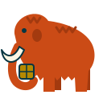
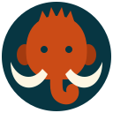

# Mascot concepts

Three placeholder mammoth concepts. Nothing here is final; pick a direction, then have it refined.

| Concept            | Idea                                                         | Preview                     |
| ------------------ | ------------------------------------------------------------ | --------------------------- |
| [A](mammoth-a.svg) | Side profile, walking, trunk curled around a cache block     |  |
| [B](mammoth-b.svg) | Front-facing badge: domed head, fur tuft, tusks curving up   |  |
| [C](mammoth-c.svg) | Minimal icon for favicons and small sizes (readable at 16px) |  |

## Keep it our own

The mammoth nods to Gradle's elephant but must be clearly distinct from it. Gradle's logo is a
registered trademark, and its
[trademark guidelines](https://gradle.com/legal/gradle-trademark-usage-guidelines/) don't allow
look-alikes without written permission. These concepts were drawn from scratch, not traced or
adapted from Gradle's artwork, and keep to these rules:

- **Unmistakably a mammoth:** high domed head, shoulder hump with a back sloping down to the hips,
  shaggy fur, small ears and large curved tusks.
- **Faces left** (or front, for the badge), with its own pose.
- **Our palette only:** colors from [palette.json](../palette.json), never Gradle's.
- **No reuse** of Gradle's shapes, outlines or proportions.
