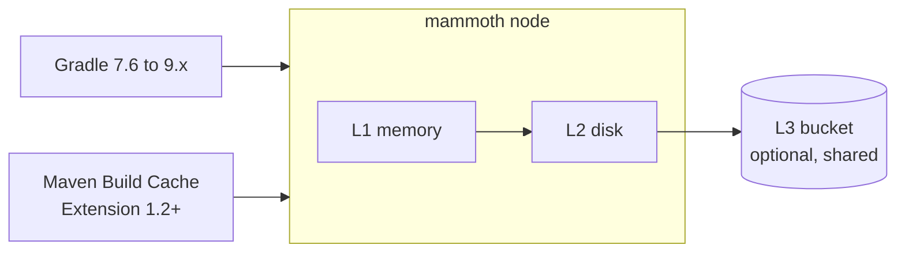

# mammoth-cache

**A build cache that never forgets.** mammoth-cache is a fast, open-source remote build cache node
for Gradle and Maven, written in Rust. It is a drop-in replacement for the Gradle Build Cache Node,
which reaches end of life after December 31, 2026.

> [!WARNING]
> mammoth-cache is pre-alpha. It serves Gradle builds from memory today; disk and bucket storage,
> Maven, authentication and metrics are on the way. See
> [feature status](user/README.md#feature-status).

## Why mammoth-cache

- **Drop-in.** Same `/cache/` path, port 5071 and `/ping` as the Build Cache Node. Point Gradle at
  a new host and keep going. [Migration guide](user/migrating.md).
- **Fast.** Entries stream from memory, local disk or an object-store bucket, with low tail latency
  as an engineering goal, because every lookup sits on a build's critical path.
- **Stateless.** With a shared S3, GCS or Azure bucket, nodes hold only copies. Scale out behind a
  load balancer, and replace a failed node with a fresh one.
- **Simple to run.** One static binary or a distroless image, and one TOML file. No web UI, no
  database, no JVM.
- **Observable.** Prometheus metrics with a documented catalog, and Kubernetes-style health checks.
- **Open.** MIT or Apache-2.0, with every design decision written down.

## How it works

A lookup tries memory, then disk, then the bucket, and copies a hit into the faster tiers. A store
lands on disk and uploads to the bucket in the background.

## Get started

- [Quickstart](user/quickstart.md): run a node with Docker or from source.
- [Gradle](user/gradle.md) and [Maven](user/maven.md) setup.
- [Configuration reference](user/configuration.md).

## Learn more

- [Philosophy](philosophy.md): the principles behind the design.
- [Design docs](design/README.md): how it works and why, decision by decision.
- [Source on GitHub](https://github.com/nevzheng/mammoth-cache), where issues and
  [discussions](https://github.com/nevzheng/mammoth-cache/discussions) are welcome.
