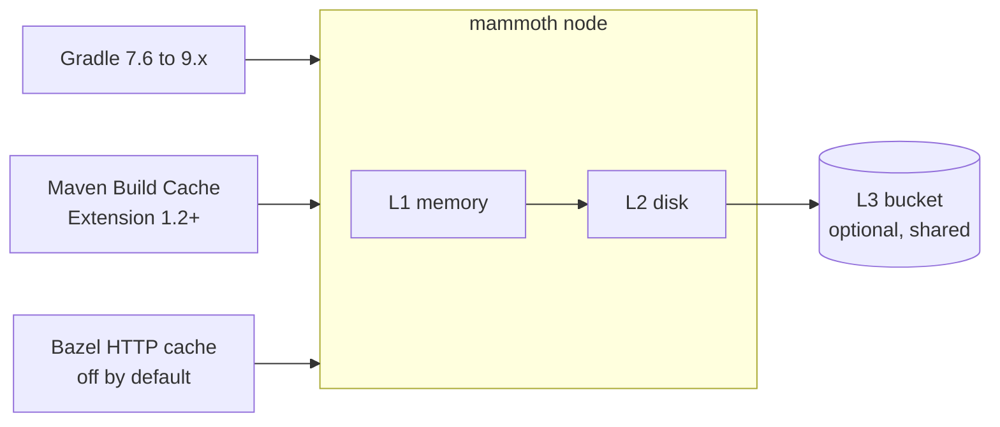

# mammoth-cache

**A build cache that never forgets.** mammoth-cache is an open-source, self-hosted remote build
cache for Gradle, Maven and Bazel, written in Rust. It is a drop-in replacement for the Gradle Build
Cache Node, which reaches end of life after December 31, 2026: same `/cache/` path, same port, same
`/ping`, and no Develocity. One static binary, a few lines of config and a load balancer, and your
builds keep their cache.

> [!WARNING]
> mammoth-cache is pre-alpha. It serves Gradle, Maven and (off by default) Bazel builds from memory,
> disk and an optional bucket, configured by `mammoth.toml`, with token authentication, graceful
> shutdown and optional built-in TLS. There is no release yet, and part of the metrics catalog is
> still being wired up. See [feature status](user/README.md#feature-status).

## Why mammoth-cache

- **Drop-in.** Same `/cache/` path, port 5071 and `/ping` as the Build Cache Node. Point Gradle at
  a new host and keep going. [Migration guide](user/migrating.md).
- **Fast.** Entries stream from memory, local disk or an object-store bucket, with low tail latency
  as an engineering goal, because every lookup sits on a build's critical path.
- **Stateless.** With a shared S3, GCS or Azure bucket, nodes hold only copies. Scale out behind a
  load balancer, and replace a failed node with a fresh one.
- **Easy to operate.** One dependency, a bucket, and even that is optional. Add a few lines of
  config and a load balancer, and you're set. One static binary or a distroless image; no web UI,
  no database, no JVM. TLS at the proxy by default, or on the node with two more lines.
- **Observable.** Prometheus metrics with a documented catalog, Kubernetes-style health checks, and
  a drain on `SIGTERM` that leaves rotation before the process exits.
- **Honest about failure.** A full disk or a dead bucket costs misses, never errors, so Gradle keeps
  its cache on. `SIGTERM` drains the node out of rotation before it exits.
- **Open.** MIT or Apache-2.0, with every design decision written down.

## What it is not

Not a remote execution system or a REAPI server (use
[bazel-remote](https://github.com/buchgr/bazel-remote) for Bazel's gRPC cache), not a Develocity
replacement (its plugin, extension and build scans are out of scope), not a web UI, and not a
replicated cluster: the bucket is the shared state.

## How it works

A lookup tries memory, then disk, then the bucket, and copies a hit into the faster tiers. A store
lands on disk and uploads to the bucket in the background.

## Get started

- [Quickstart](user/quickstart.md): run a node with Docker or from source.
- [Gradle](user/gradle.md), [Maven](user/maven.md) and [Bazel](user/bazel.md) setup.
- [Deployment](user/deployment.md): load balancers, Kubernetes, TLS, sizing.
- [Configuration reference](user/configuration.md).

## Learn more

- [Philosophy](philosophy.md): the principles behind the design.
- [Design docs](design/README.md): how it works and why, decision by decision.
- [Source on GitHub](https://github.com/nevzheng/mammoth-cache), where issues and
  [discussions](https://github.com/nevzheng/mammoth-cache/discussions) are welcome.
