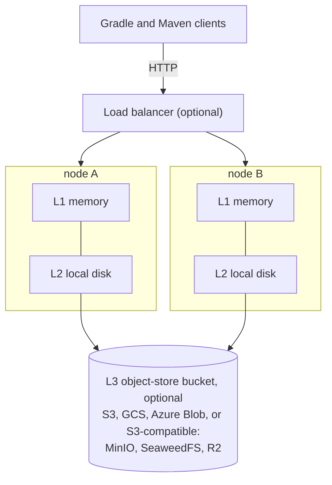
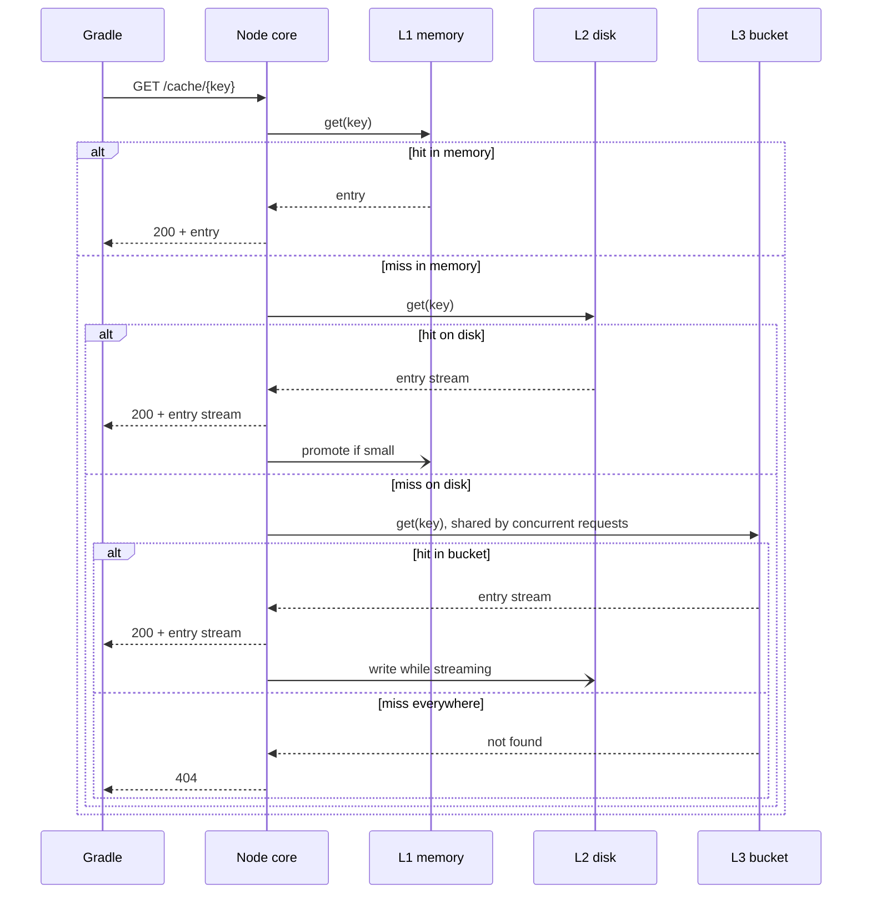
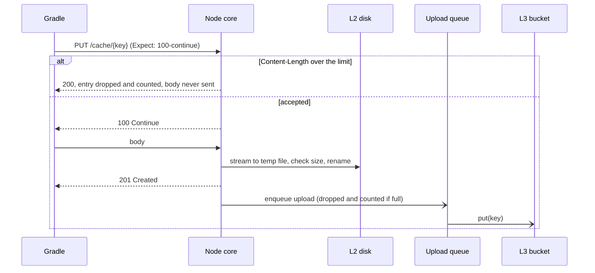
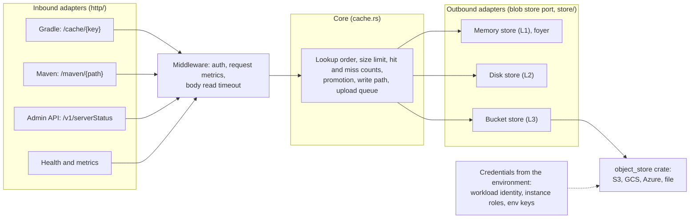
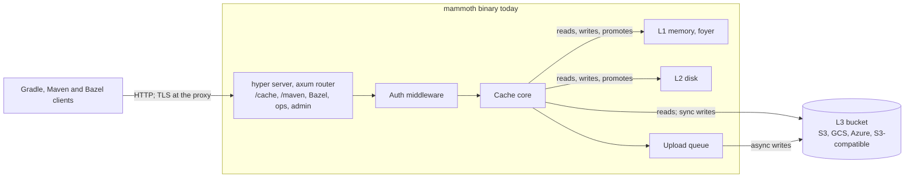

# 0003: Architecture

## Status

Draft

## Summary

A mammoth-cache node keeps cache entries in three tiers: memory (L1), local disk (L2) and an
optional object-store bucket (L3). Nodes are stateless: everything a node holds is a copy of what
is, or will be, in the bucket. Scale up with a bigger node or out with more nodes sharing one
bucket. Recover from a failure by starting a new node, which refills from the bucket as it serves.

## Context and scope

Gradle's remote build cache stores immutable entries under content-derived keys (see
[0001](0001-api-contracts.md)). A lost entry costs one rebuild of one task, never correctness. That
makes a build cache much simpler than a database: no entry ever changes, so copies never disagree,
and losing data is a performance problem, not an outage.

The Develocity Build Cache Node keeps entries on one node's disk, with replication between nodes
managed by Develocity. This doc covers a single node's storage and how nodes combine. The protocol,
auth and metrics are in their own docs.

## Goals and non-goals

### Goals

- Low latency and high throughput: serving a hit should cost little more than the memory or disk
  read behind it. Not strictly required of a cache, but held to as an engineering standard.
- Stateless nodes: any node can be killed and replaced without data loss beyond its local copies.
- Scale vertically (more memory, disk and cores) and horizontally (more nodes).
- Work as a single node without a bucket, like the Build Cache Node.
- Keep the design as simple as the problem allows.

### Non-goals

- Replication or synchronisation between nodes. The bucket is the only shared state. Recognised as
  a possible future direction for higher availability, but not recommended now.
- Consistency guarantees beyond those immutable entries already give.
- Deleting from the bucket. Expiry there is left to the bucket's lifecycle rules.
- A web UI. Operators use the config file, `/metrics` with their own dashboards, and the admin API.

## Design objectives and constraints

### Objectives, in priority order

When two objectives conflict, the earlier one wins.

1. **Hit rate.** The largest effect on build time. Set by capacity, eviction and admission, and
   measured as hits over lookups (design doc 0004).
2. **Tail latency of hits and misses.** A build performs hundreds to thousands of lookups on its
   critical path, so p99 matters more than the mean. Misses count too: with a bucket, every miss
   pays an object-store round trip, often tens of milliseconds.
3. **Throughput.** Large entries and many concurrent CI agents, bounded by disk and network.
4. **Simplicity.** Only as complex as the objectives above require.

Network round trips usually outweigh server time, so the aim for 2 and 3 is server overhead small
enough not to matter.

### Constraints

From Gradle's HTTP build cache client:

- Entries are opaque, immutable bytes under keys Gradle computes from task inputs.
- Gradle reads only status codes. Some fail the build; most other errors turn the remote cache off
  for the rest of the build ([0001](0001-api-contracts.md)).
- No backoff: `Retry-After` is ignored, so `429` and `503` cannot be used to pace clients.
- No refusal is free. The Gradle user guide says `413` on store only skips the entry, but the client
  code turns the remote cache off for that too.
- HTTP Basic is the only authentication ([0002](0002-authentication.md)).
- `Expect: 100-continue` must be honoured, so refused uploads are never sent.

From the environment:

- Object stores have tens of milliseconds of latency per request and charge per request.
- Nodes may be replaced at any time; local memory and disk are not durable.

## Design

### Overview

Nodes are stateless and interchangeable; the bucket is the only shared state.

### Tiers

| Tier | Holds                                | Bounded by                               | Eviction                                     |
| ---- | ------------------------------------ | ---------------------------------------- | -------------------------------------------- |
| L1   | Hot entries up to a size threshold   | Configured bytes                         | `memory.eviction`, S3-FIFO by default (0010) |
| L2   | Recently used entries, one file each | Configured bytes, free-space buffer, age | LRU by bytes, plus maximum age               |
| L3   | Every stored entry                   | The bucket                               | Bucket lifecycle rules (for example 30 days) |

Every key in every tier carries its protocol's namespace (`gradle/<hex key>`, `maven/<path>`), so a
Maven path can never collide with a Gradle hash. Gradle entries are immutable; Maven objects may be
replaced, because they are not content-addressed ([0001](0001-api-contracts.md)).

Large entries skip L1 so that one big artifact cannot flush many small, hot ones. L2 writes go to a
temporary file renamed into place, so a crash never leaves a partial entry.

### Read path

1. Look up L1, then L2, then L3. Stop at the first hit.
2. A hit in a lower tier is promoted: an L3 hit streams to the client while it is written to L2,
   and an L2 hit small enough for L1 is copied there.
3. Concurrent requests for the same missing key share one bucket fetch.
4. A miss in every tier is a `404`.

Entries are streamed, never buffered whole, except those small enough for L1.

### Write path

1. Accept and drop an oversized upload (`Content-Length` over the entry limit): answer `200`
   without storing it, and count it. With `Expect: 100-continue` the body is never sent; without
   it, the body is read and discarded, since closing the connection early is also an error to
   Gradle. An upload that passes the limit mid-stream is dropped the same way.
2. Stream the body to a temporary file in L2, checking the size limit as bytes arrive.
3. Rename it into place, then answer the client.
4. Upload to L3 in the background through a bounded queue.

Answering before the upload finishes is safe because entries are reproducible: an upload lost to a
crash costs a later miss, nothing more. A node set to wait for the upload before answering trades
`PUT` latency for a smaller window in which other nodes cannot see the entry.

A `PUT` for a key already present in any tier answers at once and writes nothing.

### Integrity

Gradle's keys are hashes of a task's inputs, not of the stored bytes, so a key cannot verify its
entry. Each entry is stored with a CRC32C checksum of its bytes
([0010](0010-memory-tier-and-eviction.md)), and the bad copy is deleted locally when a check fails.

How a failure looks to the client depends on when it is found. A damaged L2 header is found before
the response starts, so it is a miss. The body checksum is a trailer, checked as the body streams,
so a mismatch is found only after `200` and most of the bytes have gone out: the response is cut
short, the client sees a failed download (Gradle turns its remote cache off for the rest of the
build), and the next request for the key misses. Verifying small entries before answering would
turn that into a clean miss; whether to is an open question below. Counting these in
`mammoth_cache_integrity_errors_total` is not implemented yet.

### Statelessness and recovery

L1 and L2 are caches of L3. On restart a node rebuilds its L2 index from the entry headers, so it
starts warm; files that are not valid entries, and entries past their maximum age, are deleted. A
failed node is replaced by a new one, which fills L1 and L2 from the bucket as requests arrive.
There is nothing to back up except the bucket.

Without a bucket, the node's disk is the only copy, as with the Build Cache Node. Losing that disk
loses the cache, which is acceptable for a cache.

### Scaling

- **Vertical:** more memory enlarges L1, more disk enlarges L2, and more cores serve more requests
  in parallel.
- **Horizontal:** add nodes behind a load balancer, all using the same bucket. Because entries are
  immutable, nodes need no coordination. An entry written through node A is visible from node B
  once its upload completes; until then B reports a miss, which is harmless.
- Routing requests for the same key to the same node, for example with a consistent-hash load
  balancer on the request path, raises L1 and L2 hit rates. Recommended, not required.

### Code structure: ports and adapters

The code follows a hexagonal (ports and adapters) structure. Every tier is a key-value store of
immutable blobs: a key maps to bytes plus a little metadata (size, checksum, creation time), with
no updates and no transactions. Recency and frequency live in each tier's eviction policy, not in
the entry ([0010](0010-memory-tier-and-eviction.md)).

Single-flight bucket reads are not built yet; [Implementation status](#implementation-status) has
the details.

- **Core:** the tiering rules above. It depends only on ports, never on HTTP, a file system or a
  cloud SDK.
- **Blob store port:** `get` (a stream), `put` (a stream), `head`. All three tiers implement it, so
  implementations can be swapped and tests can use in-memory fakes.
- **Bounded store port:** what only the local tiers have, which is capacity, current size and
  eviction. The bucket does not implement it; its expiry is lifecycle rules.
- **Inbound adapters:** the protocol routes from [0001](0001-api-contracts.md), one axum router per
  protocol ([0008](0008-supported-clients.md)). They translate HTTP to core calls and core errors to
  AIP-193 responses, and keep each protocol's own status rules.

### Flow control

Gradle has no backoff: it ignores `Retry-After`, and a `429` or `503` turns the remote cache off for
the rest of the build. So there is no rate limiting, and the server avoids refusing work. Overload
is handled inside instead:

- Bounded concurrency for each tier's I/O, with bounded queues in front of it, so a slow disk or
  bucket slows requests rather than exhausting memory.
- Timeouts on every tier operation. A bucket read that times out is a miss, not an error, and after
  any bucket failure the bucket is skipped for a cooldown (`bucket.timeout`, `bucket.cooldown`).
- A limit on open connections, so excess clients wait in the listen queue.
- When the bucket upload queue is full, the upload is dropped and counted. That costs a later miss
  only.
- There is no refusal Gradle survives with the cache still on (`413` included). Oversized entries
  are already accepted and dropped; doing the same to shed load under overload is an open
  question.

## Implementation status

As of 2026-10-14 (`main` at `c03e77f`, plus the drain and readiness change). The design above is
the target; this section says how much of it the code does today, and is updated as parts land.

| Area                         | State                                                                                        |
| ---------------------------- | -------------------------------------------------------------------------------------------- |
| Gradle and Maven routes      | Done: `GET`, `HEAD`, `PUT`; Maven `OPTIONS` and `MKCOL`; namespaced keys                     |
| Entry size limit             | Done: accept and drop for Gradle, `413` for Maven, by `Content-Length` and while streaming   |
| L1 memory                    | Done: foyer, five eviction policies, eviction counter                                        |
| L2 disk                      | Done: atomic writes, CRC32C, warm index, LRU and age; set by `[disk]`                        |
| L3 bucket                    | Done: S3 and S3-compatible, GCS, Azure, local files; set by `[bucket]`                       |
| Core read path               | Lookup in order, failed tier skipped, hits promoted to faster tiers; no single-flight        |
| Core write path              | Writes every local tier at once; bucket inline or through a bounded upload queue             |
| Configuration (0005)         | Done: `mammoth.toml`, `config check`; some keys validated but not enforced yet               |
| Authentication (0002)        | Done: users, token hashes, scopes, Basic and Bearer; open until configured                   |
| Metrics (0004)               | Request counters and memory evictions only; the rest of the catalog is missing               |
| Health                       | Done: `/ping`, `/livez`; `/readyz` checks config, shutdown, disk writability and free space  |
| Flow control                 | Idle and body read timeouts, upload queue, bucket deadline and cooldown; no per-tier limits  |
| TLS                          | In progress; terminate at the proxy until then                                               |

Without `[disk]`, a node keeps nothing across a restart, and entries are capped at
`memory.max_entry_size`.

## Cross-cutting concerns

### Performance

The priorities are in [Design objectives and constraints](#design-objectives-and-constraints).
Initial targets, to be checked by benchmarks before they are relied on:

| Measure                                         | Target                          |
| ----------------------------------------------- | ------------------------------- |
| Server time for an L1 hit on a small entry, p99 | Under 1 ms                      |
| L2 hit throughput                               | Limited by disk, not the server |
| Memory beyond L1                                | Small and bounded under load    |

### Security

Client authentication is in [0002](0002-authentication.md).

#### Bucket access

L3 sits behind the blob store port (get, put, head), backed by the `object_store` crate, which
speaks S3, GCS, Azure Blob and the local file system. Apache OpenDAL is the fallback
([0006](0006-server-framework.md)).

Credentials come from the environment, never from the config file. The `object_store` crate reads
each cloud's usual variables and metadata endpoints, so workload identity works without code of
our own. Checked against `object_store` 0.14:

| Platform | Picked up automatically                                                                |
| -------- | -------------------------------------------------------------------------------------- |
| AWS      | EKS IRSA and Pod Identity, ECS task roles, EC2 instance roles, `AWS_*` keys and tokens |
| GCP      | GKE Workload Identity and VM service accounts, key files, `gcloud` user credentials    |
| Azure    | AKS Workload Identity, managed identity, keys, SAS tokens, client secrets, `az` logins |
| Others   | S3-compatible stores (MinIO, SeaweedFS, R2) with `AWS_*` keys and `bucket.endpoint`    |

Not supported, deliberately for now: AWS profiles and SSO from `~/.aws/config` (laptop flows, not
server ones), and GCP "external account" federation from outside Google Cloud (use a key file in a
Secret instead). Cross-account AWS access works through IRSA, whose role may live in another
account, or through the bucket policy. Covering these would mean the AWS SDK credential chain and
Google's auth library, which [0006](0006-server-framework.md) chose against.

The config file names only the bucket, region, key prefix and, for S3-compatible stores, an
endpoint, plus `allow_http` for one without TLS. It never holds keys.

Requests the node sends: a single `PUT` for entries up to 5 MiB; above that a multipart upload
(create, parts four at a time, complete), aborted if the body fails; `GET` and `HEAD` for reads.
The node needs `get`, `put` and `head` on its prefix, plus aborting its own multipart uploads
(`s3:AbortMultipartUpload` on S3), and nothing else: no `delete`, and no listing. S3 still needs
`s3:ListBucket` on the prefix to answer a missing key with `404` rather than `403`.
Expiry is the bucket's lifecycle rules.

### Observability

Every tier reports hits, misses, latency, size and evictions. The metric catalog is in design doc
0004.

## Alternatives considered

- **Disk only, like the Build Cache Node:** simplest, but a node's loss is the cache's loss and
  nodes cannot share entries. Still supported by leaving L3 unconfigured.
- **Peer replication between nodes:** removes the bucket but adds membership, consistency and
  failure handling. Not worth it while buckets are cheap and reliable.
- **Bucket only, no local tiers:** simple and stateless, but every hit pays object-store latency.
- **Write-through to the bucket on every `PUT`:** smaller visibility window, but upload latency on
  every store. Available as a setting.

## Open questions

- Whether to shed `PUT`s under sustained overload by accepting and dropping them, as oversized
  entries are.
- The default L1 size threshold for an entry.
- Which object stores to support first.
- Whether to read and verify entries small enough for L1 before answering, so a checksum mismatch
  is a clean miss rather than a cut-off response.
- Whether to put a short-lived negative cache or a filter (for example a Bloom filter) in front of
  the bucket, so misses avoid an object-store round trip.
