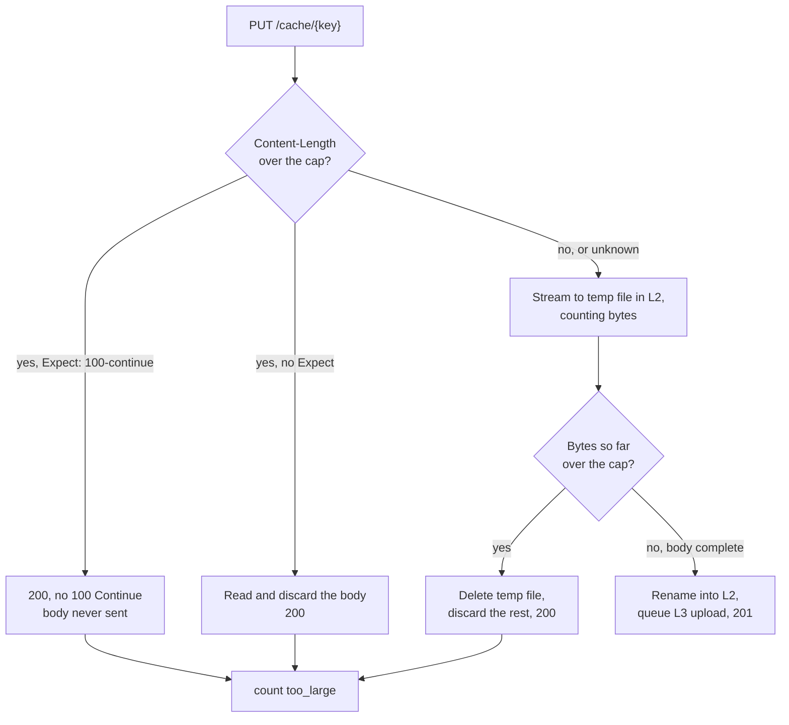

# 0007: Entry size limits and admission

## Status

Draft

## Summary

mammoth-cache caps the size of an entry it stores, 100 MiB by default as in the Build Cache Node,
and the cap can be raised or turned off. An oversized `PUT` is accepted and dropped: the client gets
a success status, the bytes are discarded, and a metric counts it. A second, smaller threshold keeps
large entries out of memory. This doc explains why a cap protects hit rate in a cache bounded by
bytes, gives the arithmetic and a simulation behind the defaults, and specifies what each tier
admits. The simulation's workload is synthetic, so its numbers are modelled, not measured; the doc
says which is which throughout.

## Context and scope

The L1 memory and L2 disk tiers from [0003](0003-architecture.md) are bounded by bytes. Every byte
one entry holds is a byte no other entry can use. Gradle itself puts no cap on entry size, so the
server is the only place to apply one. The Build Cache Node (BCN) defaults to a 100 MiB
`cache.maxArtifactSize` and a 50 GiB target size
([Develocity build cache docs](https://docs.develocity.ai/2026.2/administration/build-acceleration/build-cache/)),
and evicts least recently used entries.

The project decided (2026-10-14) that an oversized store is accepted and dropped, answered with
`200`, as [0001](0001-api-contracts.md) and [0003](0003-architecture.md) now say. This doc gives the
reasoning behind the limit and the details of the drop.

This doc covers:

- Why there is a cap at all, and why 100 MiB is the default.
- The memory threshold.
- What each tier admits. Eviction policies are in 0009
  ([#13](https://github.com/nevzheng/mammoth-cache/pull/13)).
- What the node does with an oversized `PUT`.

The bucket tier (L3) has no eviction of its own; its lifecycle rules apply, as in 0003.

## Goals and non-goals

### Goals

- Protect hit rate, the first objective in [0003](0003-architecture.md), from a few large entries.
- Bound the disk space and bandwidth an in-flight upload can take.
- Keep BCN-compatible defaults, and let operators turn the cap off.
- Never fail a build or turn Gradle's remote cache off because an entry is too large.

### Non-goals

- An optimal policy for every workload. The defaults should be good, and the metrics should show
  when to change them.
- Per-project or per-user quotas.
- Choosing what Gradle caches. That is the build author's decision.

## Design objectives and constraints

The objective is build time saved, which is close to hit ratio but not the same:

- **Hit ratio** (hits over lookups) is what Develocity and [0004](0004-metrics.md) report, and what
  operators watch.
- **Byte hit ratio** (bytes served over bytes requested) is what a CDN optimises. It is the wrong
  target here: one 2 GiB hit counts as much as 100,000 hits of 20 KiB.
- **Time saved** is what users feel: for each hit, the task's rebuild time minus the time to
  download the entry. It is the real objective, but the server cannot see task times, so hit ratio
  stands in for it and large entries get a separate check (see "Download cost" below).

Constraints:

- Gradle reads only status codes. Any error on `PUT`, `413` included, turns the remote cache off
  for the rest of the build ([0003](0003-architecture.md)), so dropping an entry must look like
  success.
- Gradle may send `Expect: 100-continue` (the `useExpectContinue` setting on its HTTP build cache),
  which lets the node answer before the body is sent.
- Entries are immutable and reproducible. A dropped or evicted entry costs a later miss, nothing
  more.

## Design

### Why a cap protects hit rate

#### Hits per byte

Take a cache of `C` bytes. Entry `i` has size `s_i`, is requested at rate `λ_i`, and saves `b_i`
seconds per hit. If the cache could choose what to keep, the best choice is a fractional knapsack:
keep entries in decreasing order of

```text
value density = λ_i × b_i / s_i      (seconds saved per second, per byte held)
```

until `C` is full. The `s_i` in the denominator is the point. LRU ignores it: it keeps whatever was
used recently, whatever its size. A 100 MiB entry must be requested 6,400 times as often as a
16 KiB one, or save 6,400 times as much per hit, to earn its space.

#### Displacement

An entry of size `S` pushes out about `S / s̄` entries, where `s̄` is the mean size of the entries
at the cold end of the LRU. In the model below (median 16 KiB, mean about 120 KiB), one 100 MiB
entry evicts about 870 average entries, or 6,400 median ones. Admitting it raises time saved only
if

```text
λ_S × b_S  >  Σ λ_j × b_j    over the entries j it displaces
```

#### How long entries live

Under LRU every entry stays for about the same time `T` after its last use before it is evicted
(the characteristic time from Che's approximation). `T` is set by the bytes written:

```text
Σ_i s_i × (1 − e^(−λ_i × T)) = C        hit probability of entry i: h_i = 1 − e^(−λ_i × T)
```

Entries used once, the usual fate of a packaged distribution whose key changes on every commit,
each hold `S` bytes for `T` and earn nothing. A stream of them at `μ` per second takes `μ × S × T`
bytes away from everything else, and `T` can be no longer than `C / (μ × S)`.

Worked example, illustrative: CI builds `main` 200 times a day and caches a 500 MiB distribution
each time, with a new key each time. That is about 100 GiB a day. On a 50 GiB disk, `T` can be at
most 12 hours, even with nothing else in the cache. Develocity suggests sizing the cache so that
`T` matches the typical lifetime of a feature branch, often days. With the 100 MiB cap, those
distributions are dropped and `T` is set by the entries that get reused.

#### Download cost

A hit saves `b = rebuild time − (round trip + S / bandwidth)`. For compile tasks the rebuild is
seconds of CPU time and the output is small, so `b` is large. For packaging tasks (jars of jars,
distributions, images) the rebuild is mostly compressing and writing the bytes, so it also grows
with `S`.

Worked example, modelled: a 1 GiB archive written at 150 MiB/s takes about 6.8 s to rebuild plus
any compute. Downloading it at 1 Gbit/s (about 119 MiB/s) takes about 8.6 s. The hit is slower
than rebuilding unless the task also spends more than 1.8 s computing. Over a 100 Mbit/s link the
download takes about 86 s. Gradle has no way to see this and always prefers the hit.

#### Resource bounds

The cap also bounds what one upload can hold before the node knows whether to keep it:

- **Temporary disk space.** L2 writes go to a temporary file before the rename
  ([0003](0003-architecture.md)). Concurrent uploads × cap is the worst case. The BCN reserves an
  "incoming buffer" the size of its max artifact size inside the target size for the same reason; a
  [forum report](https://discuss.gradle.org/t/remote-build-cache-node-keeps-evicting-cache-entries/44696)
  shows a node that set the max to 4.8 GiB on a 10 GiB volume and could then store nothing.
- **Disk and network bandwidth.** A multi-GiB write competes with hits for disk and NIC time and
  raises their tail latency, the second objective in 0003.

### Simulation (modelled)

[`sim/size_admission.py`](sim/size_admission.py) replays a synthetic trace through a byte-bounded
LRU with different caps, and through LRU with size-aware frequency admission (see "L2" below). The
workload:

- 200,000 keys, 2,000,000 lookups, Zipf popularity with exponent 0.9, independent references.
- Sizes lognormal, median 16 KiB, σ = 2 (p90 about 200 KiB, p99 about 1.7 MiB), plus 0.05 % of keys
  log-uniform between 100 MiB and 4 GiB. Working set 111 GiB, 80 % of it in the large keys.
- Size and popularity independent. A miss stores the entry, as Gradle does after building it.
- Time saved per hit: lognormal compute (median 2 s) plus writing the output at 150 MiB/s, minus a
  5 ms round trip plus the bytes at 110 MiB/s, floored at zero.

None of these numbers is measured from a real Gradle cache. An attempt to measure entry sizes from
an open-source build was blocked by dependency downloads in the environment used to write this doc
(see "Open questions").

Results at three capacities, first quarter of the trace discarded as warm-up:

| Capacity | Policy                    | Cap     | Hit ratio | Byte hit ratio | Time saved |
| -------- | ------------------------- | ------- | --------- | -------------- | ---------- |
| 2 GiB    | LRU                       | none    | 51.8 %    | 11.7 %         | 50.6 %     |
| 2 GiB    | LRU                       | 100 MiB | 60.0 %    | 13.7 %         | 59.1 %     |
| 2 GiB    | LRU                       | 1 MiB   | 68.2 %    | 9.4 %          | 67.6 %     |
| 2 GiB    | LRU + frequency admission | 100 MiB | 76.7 %    | 15.2 %         | 76.0 %     |
| 8 GiB    | LRU                       | none    | 57.1 %    | 33.8 %         | 56.1 %     |
| 8 GiB    | LRU                       | 1 GiB   | 70.0 %    | 21.0 %         | 69.2 %     |
| 8 GiB    | LRU                       | 100 MiB | 81.0 %    | 20.0 %         | 80.5 %     |
| 8 GiB    | LRU                       | 10 MiB  | 83.2 %    | 18.6 %         | 82.8 %     |
| 8 GiB    | LRU                       | 1 MiB   | 90.8 %    | 13.0 %         | 90.9 %     |
| 8 GiB    | LRU + frequency admission | none    | 78.8 %    | 43.2 %         | 78.2 %     |
| 8 GiB    | LRU + frequency admission | 100 MiB | 87.2 %    | 20.3 %         | 86.7 %     |
| 32 GiB   | LRU                       | none    | 77.4 %    | 68.8 %         | 76.8 %     |
| 32 GiB   | LRU                       | 100 MiB | 95.2 %    | 24.2 %         | 95.0 %     |
| 32 GiB   | LRU                       | 1 MiB   | 93.7 %    | 13.5 %         | 93.8 %     |
| 32 GiB   | LRU + frequency admission | 100 MiB | 95.2 %    | 24.2 %         | 95.0 %     |

With five times as many large keys (0.2 %, a 416 GiB working set), plain LRU at 8 GiB falls to
41.5 % with no cap and 80.9 % with a 100 MiB cap. Run the script with `--big-frac 0.002` to
reproduce.

What the model shows:

1. **A cap raises hit ratio whenever the cache is smaller than the working set.** At 8 GiB, the
   100 MiB cap lifts plain LRU from 57 % to 81 %. Byte hit ratio falls, as expected: the bytes no
   longer served are the ones that saved little time.
2. **Once the cache holds every small entry, the cap stops mattering, and too low a cap starts to
   hurt.** At 32 GiB, caps from 100 MiB down to 10 MiB give the same 95 %, and 1 MiB is worse.
3. **Frequency admission captures most of the gain without a hard cutoff,** and does better still
   with the cap as a backstop (87 % at 8 GiB).
4. **The model favours ever smaller caps at small capacities,** because it treats a 50 MiB jar's
   hit as worth the same few seconds as a 5 KiB one. In real builds, outputs of 1 MiB to 100 MiB
   include the class directories and jars of large modules, which take long to compile. That is
   why the default stays at 100 MiB and does not follow the model down.

### Limits and their defaults

| Setting                           | Default  | Applies to          | Effect when exceeded              |
| --------------------------------- | -------- | ------------------- | --------------------------------- |
| `limits.max_entry_size`           | 100 MiB  | Every tier          | `PUT` accepted and dropped        |
| `memory.max_entry_size`           | 1 MiB    | L1                  | Stored in L2 and L3, never in L1  |

Keys are those in [0005](0005-configuration.md). `limits.max_entry_size = "none"` turns the cap
off; the key name and the `"none"` value are for 0005 to settle.

- **100 MiB** matches the BCN, so migrating users see no change. In the model it sits on the flat
  part of the curve once the cache holds the small working set (finding 2).
- **1 MiB for L1.** A 1 GiB memory tier then holds at least 1,024 entries, and in the model it
  admits 98 % of entries by count. Large entries are served from L2 by streaming, so they gain
  little from memory: their transfer time dwarfs the disk read.

### Oversized `PUT`: accept and drop



1. If `Content-Length` is over the cap and the request carries `Expect: 100-continue`, answer
   `200` at once without `100 Continue`. HTTP lets a server send a final status instead
   of `100`, and the client then does not send the body
   ([RFC 9110 §10.1.1](https://www.rfc-editor.org/rfc/rfc9110#section-10.1.1)).
2. If `Content-Length` is over the cap without `Expect`, read the body and discard it, then answer
   `200`. Closing the connection early would surface as an I/O error in Gradle and turn the remote
   cache off for the build, so the node pays the bandwidth instead.
3. If the length is unknown (chunked) or under the cap, stream to a temporary file as usual. If the
   bytes received pass the cap, delete the file, discard the rest of the body and answer `200`. The
   node never holds more than the cap per upload.
4. Count every drop in `mammoth_cache_stores_total{result="too_large"}`
   ([0004](0004-metrics.md)).

`200` is the status [0001](0001-api-contracts.md) sets for a dropped entry. Gradle reads nothing but
the status code.

Entries over the L1 threshold follow the normal path into L2 and L3; they just skip memory.

### Admission by tier

Eviction policies, the memory store and per-entry metadata are in 0009
([#13](https://github.com/nevzheng/mammoth-cache/pull/13)). This doc only says which entries each
tier admits.

| Tier | Admits                                                                     |
| ---- | -------------------------------------------------------------------------- |
| L1   | Entries up to `memory.max_entry_size`; the eviction policy may admit fewer |
| L2   | Entries up to the global cap; frequency admission optional, off by default |
| L3   | Entries up to the global cap                                               |

#### Size-aware frequency admission

When a policy compares a newcomer's frequency with what it would evict, entries of different sizes
need care: the newcomer must be compared with every entry it would evict, not just the first.
Einziger, Friedman, Eytan and Manes compare three ways of doing this
([2021](https://arxiv.org/abs/2105.08770)) and recommend "aggregated victims": admit only if the
newcomer's frequency beats the sum of its victims' frequencies. The simulator uses that rule. Any
frequency-based policy offered in 0010 ([#13](https://github.com/nevzheng/mammoth-cache/pull/13))
should behave the same way with variable sizes.

#### Frequency admission in L2

L2 admits every entry under the global cap by default. Frequency admission is an option:

- **With a bucket**, rejecting an entry from L2 is cheap. It still reaches L3, and a later hit
  promotes it once its frequency is high enough. The model shows six points of hit ratio gained at
  8 GiB.
- **Without a bucket**, L2 is the only copy, and rejecting a new entry loses the next team member's
  hit on it. Gradle stores an entry right after the miss that built it, so its frequency is at most
  2 when it is offered. Admitting everything suits this case.

Turning it on by default waits for measurements from real deployments (see "Open questions").

#### L3

The bucket takes every entry under the global cap. It has no capacity pressure the node manages,
so it needs no admission policy.

## Cross-cutting concerns

### Performance

- An early `200` costs one round trip and no body bytes.
- A drained body costs the bandwidth of the upload, bounded by how fast the client sends it. The
  node discards bytes as they arrive and holds no buffer.
- A TinyLFU sketch costs one hash and a few counter updates per access.

### Observability

What operators need to see whether the cap is right, using metrics from [0004](0004-metrics.md):

- `mammoth_cache_stores_total{result="too_large"}` against all stores: how often the cap bites.
- `mammoth_cache_entry_size_bytes`: the real size distribution, which should replace this doc's
  modelled one. Its bucket boundaries should resolve 1 MiB, 10 MiB and 100 MiB.
- `mammoth_tier_oldest_entry_age_seconds{tier="disk"}`: the characteristic time `T`. If it is short
  of the feature-branch lifetime, the disk is too small or the cap too high.

A new counter, `mammoth_cache_dropped_bytes_total`, would show the bytes dropped, including those
drained and those never sent. It is proposed here for 0004 to adopt.

### Operations

- Raising the cap above the disk's free space buffer can stop the node from storing anything, as the
  BCN report above shows. The node should refuse to start if the cap is larger than a set fraction
  of the L2 size; the fraction is an open question.
- A user who caches large outputs on purpose can raise the cap or turn it off, and can watch
  `oldest_entry_age_seconds` fall in exchange.

## Alternatives considered

- **No cap.** Gradle has none, and it would be simplest. Rejected as the default for the reasons
  above, kept as a setting.
- **Refuse with `413`.** The BCN does this, and the body is never read. Gradle's user guide says
  `413` only skips the entry, but its client turns the remote cache off for the rest of the build
  ([0003](0003-architecture.md)). It remains available as the `Reject` oversize policy
  ([0001](0001-api-contracts.md)).
- **Close the connection on an oversized body.** Saves bandwidth, but Gradle sees an I/O error and
  turns the remote cache off for the rest of the build.
- **Probabilistic size-aware admission (AdaptSize).** Admits an entry with probability falling
  exponentially with its size, tuned online. It raised hit ratio 30 % to 48 % over Nginx in a CDN's
  memory cache
  ([Berger, Sitaraman and Harchol-Balter, NSDI 2017](https://www.usenix.org/conference/nsdi17/technical-sessions/presentation/berger)).
  The 2021 paper above finds it underuses large caches, its hit ratio barely improving from 100 GB
  to 10 TB, and its tuning adds moving parts. Frequency admission plus a cap gets the same effect
  more simply.
- **Greedy-Dual-Size-Frequency (GDSF) and learned policies (LHD, LRB).** Competitive on hit ratio
  in the 2021 paper's comparison, but slower per access, with LRB about an order of magnitude more
  overhead. Not worth the complexity before real traces show a need.
- **Bigger entries straight to the bucket, skipping L2.** Would keep L2 for small entries while
  still storing large ones. Worth revisiting if users need large entries cached; it needs a
  streaming path from client to bucket.

## Open questions

- Real entry size distributions. Measure `mammoth_cache_entry_size_bytes` on early deployments, or
  build a few open-source projects with a local build cache and histogram the entries, then rerun
  the simulator with that distribution and a real access trace.
- Does Gradle's HTTP client accept a final `200` in place of `100 Continue`, and does it keep the
  connection? Test against each supported Gradle version before relying on it.
- Should frequency admission in L2 default to on when a bucket is configured?
- The startup check on the cap as a fraction of L2 size: which fraction, and warn or refuse?
- Should the cap be per tier for L2 and L3, so a node can keep large entries in the bucket only?
