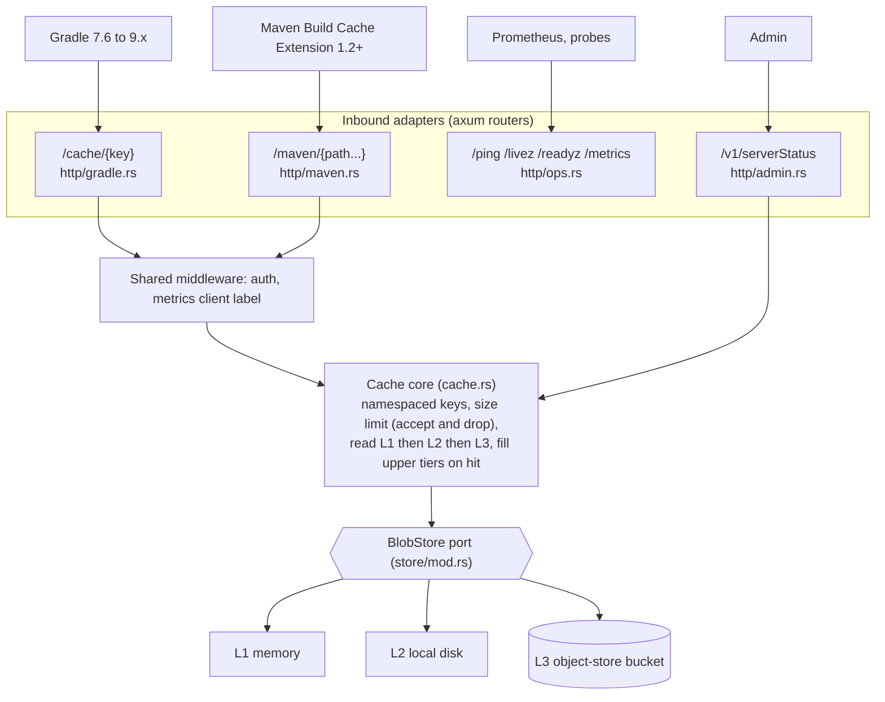

# 0008: Supported clients and acceptance testing

## Status

Draft

## Summary

mammoth-cache supports two build cache clients: Gradle's built-in HTTP build cache, from Gradle
7.6 through 9.x, and the Apache Maven Build Cache Extension, from 1.2.0 on Maven 3.9.x. Develocity
clients are out of scope. Every supported version range is covered by an acceptance suite that
runs the real client against a real `mammoth` binary in CI.

## Motivation

Users replacing the Develocity Build Cache Node need to know which clients and versions work.
The protocols are simple, but each client has quirks that unit tests against our own handlers
won't catch. Two examples: Gradle turns the remote cache off for the whole build after any
non-2xx response, and Maven only sends credentials on GET after a `401` challenge. Testing real
clients is the only way to keep a support claim honest.

## Goals and non-goals

### Goals

- State the supported client and version ranges, and the routes each one uses.
- Require acceptance tests that cover each supported range in CI.
- Define how the ranges change over time.

### Non-goals

- Develocity clients: the Develocity Gradle plugin's build cache connector, the Develocity Maven
  extension and sbt-develocity. Their protocol is undocumented, and the Maven extension needs a
  Develocity licence and server anyway.
- Bazel REAPI, which is out of scope for the project.
- Detecting or allow-listing clients by `User-Agent`.

## Design

### Supported ranges

| Client                                 | Supported range                    | Tested versions                      |
| -------------------------------------- | ---------------------------------- | ------------------------------------ |
| Gradle `HttpBuildCache`                | 7.6 to 9.x                         | 7.6.x, 8.14.x, latest 9.x            |
| Apache Maven Build Cache Extension     | 1.2.0 and later, on Maven 3.9.x    | latest 1.2.x and latest release      |
| Maven 4                                | Added once Maven 4 is GA           | latest 4.x with the latest extension |

"Tested versions" means the latest patch release of each line, resolved when the suite runs.

Gradle older than 7.6 (back to 4.3) speaks the same protocol and is expected to work, but it is
not tested or supported. Maven 3.8 and earlier are end-of-life upstream.

### Routes per client

Clients don't discover routes. Users configure a base URL and the client appends the rest.

| Client             | Configured base URL           | Requests                                     |
| ------------------ | ----------------------------- | -------------------------------------------- |
| Gradle             | `https://<host>/cache/`       | `GET`, `PUT /cache/{key}` (32-hex MD5 key)   |
| Maven extension    | `https://<host>/maven`        | `GET`, `PUT /maven/{version}/{g}/{a}/...`    |

The Maven extension writes `{version}/{groupId}/{artifactId}/{checksum}/buildinfo.xml`, the
module's artifacts and zipped extra outputs next to it, and
`{version}/{groupId}/{artifactId}/{uuid}/build-cache-report.xml`. `{version}` is `v1.1` for 1.2.x
and `v1.2` for 1.3.x. With WebDAV turned on it also sends `OPTIONS` and `MKCOL`. The contracts for
these routes live in `api/openapi/`.

### How requests flow

The server is hexagonal. Each protocol is its own inbound adapter, an axum router. Every router
calls the same `Cache` core, which reaches the storage tiers only through the `BlobStore` port.
Supporting a new client means adding a router; the core and the tiers don't change.

The Gradle namespace is write-once, because its keys are content hashes. The Maven namespace
allows overwrites, because its paths are not content-addressed.

### Client behaviour the server must respect

Gradle (7.6 to 9.x):

- Sends Basic auth preemptively on every request.
- Sends `Content-Type: application/vnd.gradle.build-cache-artifact.v1` up to 8.7 and `.v2` from 8.8.
  The server accepts any content type.
- Sends `X-Gradle-Version` and `User-Agent: Gradle/<version> (...)`.
- Sends `Expect: 100-continue` only when `useExpectContinue = true`.
- Follows redirects, PUT included, up to 10.
- Treats any non-2xx other than a `404` on GET as an error and turns the remote cache off for the
  rest of the build. Some codes (`400`, `401`, `403`, `415` and others) also fail the build.

Apache Maven Build Cache Extension (1.2.0+, through maven-resolver):

- Sends credentials on GET only after a `401` that carries `WWW-Authenticate: Basic`, and sends
  them preemptively on PUT.
- Sends `Expect: 100-continue` on every PUT by default.
- Treats `404` (and `410` from 1.3.0) as a miss. Other GET errors are logged and treated as a
  miss unless `failFast` is set. PUT errors never fail the build.
- Sends Maven's `User-Agent: Apache-Maven/<version> (...)`.

`User-Agent` and `X-Gradle-Version` feed bounded metrics labels only (see 0004). No behaviour or
auth decision depends on them.

### Acceptance suite

The suite builds `mammoth`, starts it with a test `mammoth.toml`, and runs real Gradle and Maven
builds against it. It lives in `tests/acceptance/` with small fixture projects: a Gradle Java
project with a few modules, and a Maven multi-module project with the extension configured.

The suite asserts on client output and on the server's `/metrics`. Gradle runs use
`--console=plain` so task outcomes such as `FROM-CACHE` can be read. The suite does not assert on
log wording, which changes between versions.

Every tested version runs these scenarios:

| Scenario                        | Steps                                                       | Expect                                                   |
| ------------------------------- | ----------------------------------------------------------- | -------------------------------------------------------- |
| Store                           | Clean build with push enabled, empty server                 | Entries stored; build passes                             |
| Hit                             | Wipe local caches and outputs, build again                  | Gradle tasks `FROM-CACHE`; Maven restores from cache     |
| Miss                            | Change a source file, build                                 | Changed module rebuilds; others hit                      |
| Basic auth                      | Credentials configured, anonymous access off                | Same as Hit                                              |
| Maven challenge                 | Maven without preemptive GET auth                           | `401` with `WWW-Authenticate`, then success              |
| Wrong credentials               | Bad password                                                | Gradle reports the cache error; server counts `401`      |
| Anonymous read-only             | No credentials, anonymous `read`                            | Loads hit; stores rejected without breaking Maven builds |
| Expect-continue                 | Gradle `useExpectContinue = true`; Maven default            | Stores succeed                                           |
| Oversized entry                 | Entry over the configured limit                             | `2xx`, entry dropped and counted; cache stays on         |
| Server down                     | Stop the server mid-suite                                   | Builds still pass without the remote cache               |

### CI

- A GitHub Actions workflow, `acceptance.yml`, runs the suite as a matrix of client version ×
  scenario on Linux with Java 17. Java 17 is the one JDK that every tested Gradle and Maven version
  supports.
- It runs on pull requests that touch `crates/`, `api/` or `tests/acceptance/`, and nightly
  against the full matrix, which also picks up new patch releases.
- Before a release, the full matrix must be green on the release commit.

### Changing the ranges

- A new Gradle or Maven extension major or minor line is added to the matrix when it is released.
  If it passes, the supported range grows.
- A floor moves only through a pull request that updates this doc, the matrix and the user guide
  together, and the change is noted in the release notes.

## Alternatives considered

- **Test only against the latest client versions.** This is cheaper, but it would miss the
  `v1`/`v2` media type change at Gradle 8.8 and the extension's path prefix changes.
- **Recorded HTTP fixtures instead of real clients.** These are fast, but they only replay what
  we recorded once, so they can't catch a client changing behaviour. They are fine for unit tests
  of the handlers, alongside the acceptance suite.
- **Supporting the Develocity clients.** Dropped: their protocol is undocumented, and the Maven
  extension needs a Develocity server.

## Open questions

- Whether to add a weekly smoke test for Gradle 6.9, for users stuck on older builds.
- When Maven 4 goes GA, and which extension version it needs.
