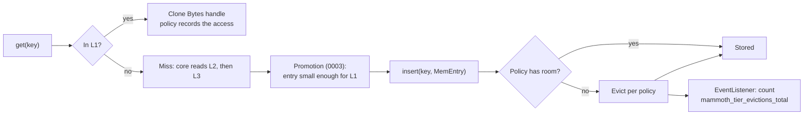

# 0009: Memory tier, eviction policies and entry metadata

## Status

Draft

## Summary

The memory tier (L1) is built on the in-memory cache from the `foyer-memory` crate, wrapped in the
existing `MemoryStore` adapter behind `BlobStore` and `BoundedStore`. foyer implements five
eviction algorithms behind one API, so the policy is a single `mammoth.toml` key,
`memory.eviction`, with S3-FIFO as the default. Capacity is counted in bytes, including a fixed
per-entry overhead so that many tiny entries cannot exceed the memory budget. Every tier shares one
small, fixed-size metadata record per entry (`EntryMeta`: size, checksum, creation time). Recency
and frequency are not part of it: they live inside the eviction policy, so a hit never writes to
shared metadata.

## Context and scope

[0003](0003-architecture.md) puts hot, small entries in memory, bounded by configured bytes, with
"admission-aware LRU (for example W-TinyLFU)" eviction. [0005](0005-configuration.md) gives it two
keys, `memory.size` and `memory.max_entry_size`. [0006](0006-server-framework.md) defines the store
ports and the on-disk entry format. The `MemoryStore` merged with the app skeleton is a placeholder:
a `HashMap` behind an `RwLock` with no eviction.

This doc covers:

- which library holds the L1 entries;
- which eviction policies are offered and how they are chosen;
- the metadata kept for each entry, in memory and in the shared entry format.

Size limits and admission thresholds (when an entry is too big for L1, or for the node at all) are
in [0007: Entry size limits and admission](https://github.com/nevzheng/mammoth-cache/pull/17) and
are not repeated here. The disk tier's file layout is out of scope; [L2](#l2-index) only notes how
it can reuse the same policies.

## Goals and non-goals

### Goals

- A maintained, off-the-shelf concurrent cache, not a hand-written one.
- Eviction policy chosen in configuration, with a default that does well without tuning.
- Memory use bounded by `memory.size`, counting metadata and bookkeeping, not only entry bytes.
- An L1 hit costs a hash lookup and a reference-count increment: no copy, no allocation.
- One metadata record shared by all tiers, so promotion between tiers needs no recomputation.

### Non-goals

- Per-policy tuning knobs (queue ratios, sketch sizes). Defaults are fixed; caches should be as
  simple as possible to operate.
- Time-based expiry in L1. Gradle entries are immutable and L1 is small, so capacity alone decides.
- Persisting L1 across restarts. Nodes are stateless (0003).
- Size-based admission rules, owned by the size limits doc.

## Design objectives and constraints

In priority order, from 0003: hit rate, then tail latency, then throughput.

- Entries are up to `memory.max_entry_size` (default 1 MiB) and highly variable in size, so the
  cache must weigh entries by bytes, not count them.
- Gradle traffic has many one-hit wonders (branch builds that nobody repeats) and occasional scans
  (a cold full build), so the policy must resist pollution.
- Dependencies are vendored under Bazel through Cargo, so dependency count and licence matter
  (`deny.toml` allows permissive licences only).

## Design

### Library: foyer

The memory tier uses `foyer_memory::Cache<CacheKey, MemEntry>`, pinned to an exact version.

| Requirement               | foyer-memory 0.22                                               |
| ------------------------- | --------------------------------------------------------------- |
| Eviction policies         | FIFO, LRU, S3-FIFO, SIEVE, W-TinyLFU, selected at construction  |
| Weighing by bytes         | `with_weighter(Fn(&K, &V) -> usize)`, capacity in `usize` units |
| Concurrency               | Sharded, lock per shard; no background threads                  |
| Eviction notification     | `EventListener::on_leave` with reason (evict, replace, remove)  |
| Coalescing misses         | `get_or_fetch` shares one fetch between concurrent callers      |
| Admission hook            | `with_filter(Fn(&K, &V) -> bool)`                               |
| Licence                   | Apache-2.0; dependency tree passes `deny.toml`                  |

foyer is developed for RisingWave's storage engine and also offers a hybrid memory and disk cache.
mammoth uses only the memory crate: L2 keeps the one-file-per-entry format from 0006 so that L2 and
L3 entries stay byte-identical.

### Eviction policies

`memory.eviction` takes one of:

| Value       | Algorithm                                                           | Best when                                           |
| ----------- | ------------------------------------------------------------------- | --------------------------------------------------- |
| `s3-fifo`   | Small probationary FIFO, main FIFO, ghost queue of recent evictions | Default. Many one-hit wonders; robust on all traces |
| `lru`       | Least recently used                                                 | Strong recency, little scanning                     |
| `w-tinylfu` | Window LRU plus frequency-sketch admission into a segmented LRU     | Stable popularity over long periods                 |
| `sieve`     | FIFO with a visited bit and a moving hand                           | Low overhead, recency-dominated traffic             |
| `fifo`      | First in, first out                                                 | Baselines and benchmarking                          |

```toml
[memory] # L1
size = "1GiB"
max_entry_size = "1MiB" # see the size limits doc
eviction = "s3-fifo"    # s3-fifo | lru | w-tinylfu | sieve | fifo
```

Each value maps to a foyer `EvictionConfig` with its default parameters, except `lru`, which
disables foyer's high-priority pool so that it is plain LRU. An unknown value is a startup error,
like any other invalid key (0005).

S3-FIFO is the default because it was at or near the top for both hit ratio and byte hit ratio on
every trace in the [simulation](#simulation), while each other policy lost badly on at least one.
S3-FIFO admits new entries into a small queue (10% of capacity) and promotes them only if they are
read again before they leave it, which is the pollution resistance 0003 asked of W-TinyLFU, at
lower cost per operation.

### Simulation

The candidates were replayed on two synthetic traces of 3 million `GET`s with cache-aside fills:
keys drawn from a Zipf(0.9) catalog of 200,000 entries, sizes log-normal with a 24 KiB median
(entries over 1 MiB removed, as L1 skips them), a share of the catalog replaced every 20,000
requests (new commits), one-hit-wonder keys, and a periodic scan of a quarter of the catalog. Trace
A replaces popular keys and has 15% one-hit wonders; trace B replaces keys uniformly and has 5%.
Capacity is 1% of the unique bytes requested.

| Library and policy  | A: hit ratio | A: byte hit ratio | B: hit ratio | B: byte hit ratio | Million requests/s, one thread |
| ------------------- | ------------ | ----------------- | ------------ | ----------------- | ------------------------------ |
| foyer `fifo`        | 0.298        | 0.298             | 0.334        | 0.308             | 4.4 to 5.2                     |
| foyer `lru`         | 0.317        | 0.316             | 0.362        | 0.339             | 3.7 to 3.9                     |
| foyer `sieve`       | 0.283        | 0.281             | 0.407        | 0.384             | 4.8                            |
| foyer `s3-fifo`     | 0.318        | 0.318             | 0.434        | 0.412             | 3.5 to 4.1                     |
| foyer `w-tinylfu`   | 0.245        | 0.244             | 0.412        | 0.390             | 2.9 to 3.5                     |
| moka LRU            | 0.317        | 0.317             | 0.363        | 0.339             | 1.0 to 1.2                     |
| moka TinyLFU        | 0.333        | 0.268             | 0.459        | 0.366             | 0.8 to 1.0                     |
| quick_cache S3-FIFO | 0.315        | 0.313             | 0.395        | 0.372             | 7.9 to 8.2                     |

At 5% of unique bytes the ranking is the same, with every ratio 10 to 15 points higher. What the
numbers show:

- The best policy depends on the trace: SIEVE and W-TinyLFU are last on A and near the top on B.
  That is the case for making the policy configurable rather than picking one forever.
- S3-FIFO is the only policy within two points of the best byte hit ratio on both traces.
- moka's TinyLFU has the best hit ratio by count but a much lower byte hit ratio: its admission
  favours small entries. In front of a disk, a hit by count saves a disk read and a hit by byte
  saves bandwidth, so neither metric alone decides. Real traces should (see
  [Open questions](#open-questions)).
- Every candidate does over a million operations per second on one thread, so the cache library is
  never the bottleneck against the 1 ms p99 target for an L1 hit (0003).

The traces are synthetic and the absolute numbers mean little; the relative behaviour is the
result. The simulation's source is kept in the project's research folder.

### Entry metadata

Every tier keeps the same facts about an entry. They are fixed size and `Copy`:

```rust
/// Facts about an entry that every tier keeps. Written once, never updated.
#[derive(Debug, Clone, Copy, PartialEq, Eq)]
pub struct EntryMeta {
    /// Length of the entry's bytes.
    pub size: u64,
    /// Checksum of the entry's bytes; the algorithm is open in 0006.
    pub checksum: Checksum,
    /// When the entry was first stored on any node, in seconds since the Unix epoch.
    pub created: u64,
}
```

| Field      | Set when                             | Used for                                                     |
| ---------- | ------------------------------------ | ------------------------------------------------------------ |
| `size`     | The body has been read               | `HEAD`, `Content-Length`, the weigher, tier usage gauges     |
| `checksum` | Computed while the body streams in   | Verifying L2 and L3 reads; writing an L2 header on promotion |
| `created`  | First `PUT` on any node; then copied | L2 `max_entry_age` expiry, age metrics                       |

`EntryMeta` is the in-memory form of the 0006 header and trailer: L2 and L3 read it from the entry
object, and L1 keeps it beside the bytes. Because a promotion carries the record along, an L3 hit
written to L2, or an L2 hit copied to L1, keeps its original `created` time and needs no second
checksum pass.

What is deliberately not in the record:

- **Last access time and hit counts.** Updating them on every hit is a write to a shared cache line
  on the hottest path, and on disk it would mean rewriting files. Recency and frequency belong to
  the eviction policy, which keeps them in its own compact form (S3-FIFO keeps a small counter per
  entry).
- **The key.** The cache holds it already as the map key, and duplicating it costs up to 128 bytes.
- **Tier or location.** Where an entry lives is a property of the store holding it, not the entry.
- **Content type or protocol.** These come from the key's namespace (see
  [Maven entries](#maven-entries)).

In L1 the cached value is:

```rust
/// An L1 entry: its metadata and its bytes, in one exact-size allocation.
#[derive(Debug, Clone)]
struct MemEntry {
    meta: EntryMeta,
    body: Bytes,
}
```

A `get` clones the `Bytes` handle out of the cache entry and releases the shard, so a hit is a
reference-count increment and the response streams from shared memory, as in the placeholder.

### Accounting

The weigher counts what the entry really costs:

```text
weight = body.len() + key.len() + ENTRY_OVERHEAD
```

`ENTRY_OVERHEAD` is a constant covering foyer's record, the hash-table slot, the `Bytes` header and
`EntryMeta`; it is about 150 bytes and is measured by a test rather than guessed. Without it, a
1 GiB tier filled with 200-byte entries would use roughly twice its configured size.

When a `PUT` arrives without a size hint, the buffer grows by doubling and can hold up to twice the
body. `MemoryStore` copies such a body into an exact-size buffer before inserting it whenever the
spare capacity exceeds an eighth of its length, so weight matches allocation.

An evicted entry stays alive while a response is still streaming it, because the response holds a
`Bytes` reference. Memory above `memory.size` is therefore bounded by concurrent L1 responses
times `memory.max_entry_size`, which the process memory guidance in 0003 must include.

### Sharding

foyer splits capacity evenly across shards, and a shard evicts within its own share. The shard
count is not configurable: `MemoryStore` uses the smallest power of two that is at least the
number of cores, then halves it until each shard holds at least 64 maximum-size entries. With the
defaults (1 GiB, 1 MiB entries) that allows up to 16 shards.

### Read and fill paths



- **Fill:** L1 is filled by promotion of L2 and L3 hits, per 0003. The core uses `get_or_fetch`
  for entries small enough for L1, so concurrent misses for one key cause one promotion.
- **`put`:** `MemoryStore::put` keeps its contract from 0006: a key already present writes
  nothing, and a failed body stream leaves nothing behind.
- **Eviction:** the `EventListener` increments `mammoth_tier_evictions_total{tier="memory",
  reason="size"}` (0004). foyer's own metrics registry stays disabled, so the 0004 catalog is the
  only set of metric names.
- **Usage:** `BoundedStore::usage` reports foyer's `usage()` as `size_bytes` and `capacity()` as
  `capacity_bytes`; `entries` is a counter maintained by `put` and the listener.

### Time and clocks

No part of this design needs a shared or synchronised clock.

- **Eviction is clock-free.** Every offered policy orders entries by queue position, visited bits or
  frequency counters, not timestamps. A hit updates policy state inside one shard and never reads
  the time.
- **`created` is read once.** It is the node's wall-clock time (`SystemTime`, whole seconds) at the
  first `PUT`, then copied with the entry between tiers. Nodes do not coordinate clocks; skew
  between nodes only shifts age-based expiry by the skew, which is harmless for a cache.
- **No per-hit timestamps.** Reading the clock is cheap (tens of nanoseconds through the vDSO), but
  storing the result in a shared entry on every hit makes cores contend for the same cache line on
  the hottest path. That is why last access is not in `EntryMeta`.
- **If a coarse time is needed** (for example an L2 index that wants access age), one `AtomicU64`
  holding seconds since start, advanced by a once-a-second tokio task and read with `Relaxed`
  ordering, gives every thread a time without a system call. Nothing in this doc needs it yet.

### Swapping the implementation

The memory tier is generic over its cache library. `MemoryStore` owns the `BlobStore` and
`BoundedStore` contracts (streaming, size checks, put-if-absent, metrics) once, and delegates
storage and eviction to a small backend trait:

```rust
/// A concurrent, byte-weighted cache with a configurable eviction policy.
pub trait MemoryBackend: Send + Sync + fmt::Debug + 'static {
    /// Builds the cache. Fails if this backend does not offer `policy`.
    fn new(config: &MemoryConfig, listener: EvictionListener) -> Result<Self, ConfigError>
    where
        Self: Sized;

    fn get(&self, key: &CacheKey) -> Option<MemEntry>;
    /// Inserts, replacing any existing value; evicts per the policy to make room.
    fn insert(&self, key: CacheKey, entry: MemEntry);
    fn remove(&self, key: &CacheKey) -> Option<MemEntry>;
    /// Weighted bytes held and the capacity, for `BoundedStore::usage`.
    fn usage(&self) -> (u64, u64);
}

pub struct MemoryStore<B: MemoryBackend = FoyerBackend> { backend: B, /* counters */ }

/// Parsed from `memory.eviction`; independent of any library.
pub enum EvictionPolicy { S3Fifo, Lru, WTinyLfu, Sieve, Fifo }
```

- **Default:** `FoyerBackend`, the only backend in the default build. It maps every
  `EvictionPolicy` to a foyer `EvictionConfig`.
- **Others:** a moka or quick_cache backend is one file implementing `MemoryBackend`, behind a Cargo
  feature, accepting the policies it supports and rejecting the rest at startup.
- **Static dispatch:** `MemoryStore` is generic, not `dyn`, so the hot path pays no virtual call.
  The binary picks the backend at compile time; there is no backend key in `mammoth.toml`.
- **Tier level:** above this, the memory tier is still just one `BlobStore` adapter (0006), so the
  core never sees the backend.

`EvictionPolicy` is a list of names, not a trait: the policies themselves are implemented by the
library. A policy no library offers would be added by implementing `MemoryBackend` for a
hand-written cache, which this seam allows but this doc does not plan.

### Maven entries

The Maven namespace (in review for 0001) stores objects that are not content-addressed and can be
replaced. The design already allows for it: keys carry their namespace (`gradle/…`, `maven/…`), a
replacing `put` uses foyer's `insert`, which swaps the value atomically (the listener sees a
`Replace` event and counts no eviction), and `created` becomes the time of the latest write.

### L2 index

The disk tier needs an in-memory index (key to `EntryMeta`) for its own eviction. A foyer cache
whose value is `EntryMeta`, weighed by `size`, can be that index: its eviction listener queues the
file for deletion, and `disk.eviction` takes the same values as `memory.eviction`, defaulting to
`lru` as in 0003. The listener must only enqueue, never unlink inline, because it runs under a
shard lock. Age expiry (`max_entry_age`) stays a separate sweep over `created`. On a warm start the
index is rebuilt by scanning entry headers in `created` order. This is a proposal for the disk tier
design to accept or replace.

## Cross-cutting concerns

- **Performance:** a hit takes one shard lock briefly and does no allocation. No background
  threads; eviction runs inline on insert, so its cost lands on promotions, not on hits.
- **Memory:** bounded as described in [Accounting](#accounting).
- **Observability:** the 0004 tier metrics cover hits, misses, evictions and usage. The active
  policy is logged at startup and reported in `/v1/serverStatus`.
- **Integrity:** L1 bytes are not re-checked on each hit. They were verified when they entered L1,
  either by checksum on promotion or while streaming on `PUT`.
- **Dependencies:** foyer-memory adds about 50 crates (moka about 15, quick_cache about 10), all
  under licences `deny.toml` allows.

## Alternatives considered

- **moka:** the most widely used Rust cache, with TTL and a mature API. It offers only TinyLFU and
  LRU, was three to five times slower per operation in the simulation, does maintenance in batches
  that briefly let it exceed capacity, and its TinyLFU had the lowest byte hit ratio of the
  frequency-aware policies. Kept as the fallback if foyer stalls: it fits behind `MemoryStore` and
  the same config key with a smaller set of values.
- **quick_cache:** the fastest and lightest candidate, but one policy only (an S3-FIFO variant), so
  no configuration. A good choice if configurability is dropped.
- **stretto (Ristretto port):** little maintenance activity and a much smaller user base.
- **`lru` or a hand-written cache:** single-threaded or a global lock, and every policy would be
  ours to write, test and tune.
- **foyer's hybrid cache as L2:** it uses its own block format, so L2 entries would no longer match
  L3 objects and promotion would need re-encoding (0006).

## Open questions

- **Policy choice on real traffic.** Replay real access logs (`log.access_log`) through each policy
  before 1.0 and revisit the default. A `mammoth replay` tool would let operators do the same.
- **Hit ratio by count versus by byte.** If real traces favour moka's TinyLFU, offer it as an
  extra `memory.eviction` value backed by moka.
- **Filling L1 on `PUT`.** 0003 fills L1 only on promotion. Inserting small uploads directly would
  serve the next build's reads from memory; S3-FIFO's probation queue limits the cost when they are
  never read. Needs a decision in 0003.
- **foyer before 1.0.** Minor releases may break the API; upgrades are deliberate and contained in
  `MemoryStore`.
- **The checksum algorithm** (CRC32C or BLAKE3, open in 0006) sets the size of `Checksum`, and so of
  `EntryMeta`: 24 or 48 bytes.
