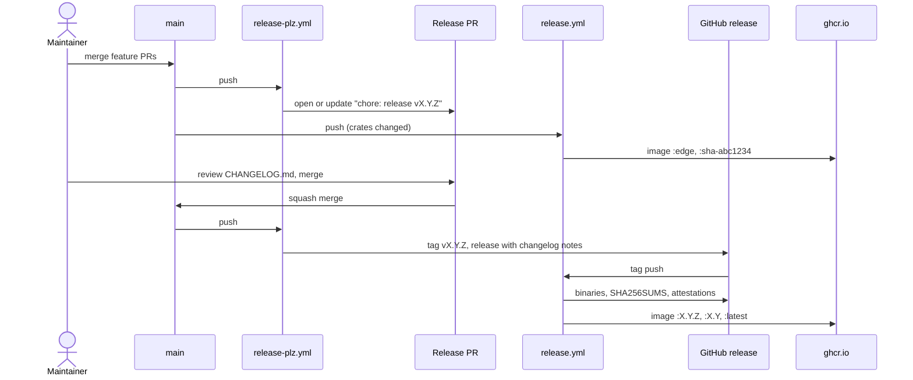

# 0009: Releases and packaging

## Status

Accepted

## Summary

Releases are cut by merging a release PR. On every push to main, release-plz opens or updates a PR
that bumps the version and writes `CHANGELOG.md` from the Conventional Commit titles merged since
the last release. Merging it tags `vX.Y.Z` and creates the GitHub release. The tag starts a build
that attaches static Linux binaries (amd64, arm64) and a macOS arm64 binary to the release, and
pushes a multi-arch image built from those same binaries to `ghcr.io/nevzheng/mammoth-cache`. Every
push to main also publishes an `edge` image. Nothing is published to crates.io.

## Context and scope

mammoth-cache is a server that replaces the Gradle Build Cache Node. Its users run it the way they
ran the node: as a container (Docker, Kubernetes) or as a process on a VM. So the release has two
products, a container image and a standalone binary, and both should be easy to pin and verify.

The repository already has Conventional Commit PR titles (checked by `conventional-title`),
squash-only merges, a DCO check, a main ruleset that requires PRs, and a `docker.yml` that pushed
amd64 and arm64 images on `v*` tags by compiling the arm64 image under QEMU. No release has been cut
yet. release-plz and cargo-dist were suggested earlier and not added. Bazel with rules_rust is
planned alongside Cargo.

This doc covers versioning, the release flow, the artifacts and their verification, and what the
maintainer configures once. Helm charts and OS packages are out of scope.

## Goals and non-goals

### Goals

- One maintainer action to release: merge the release PR.
- A changelog written from the commit history, with no hand-kept file to forget.
- Container images for linux/amd64 and linux/arm64, and binaries that run on any Linux distribution.
- The image and the downloadable binary are the same build.
- Provenance a user can check: checksums, and build attestations for binaries and images.
- Pre-release images from main (`edge`) for people testing ahead of a release.

### Non-goals

- Publishing to crates.io. The Rust API is not a product, and `cargo install` is not how a cache
  server is deployed. This can change later (see [Open questions](#open-questions)).
- Windows binaries, Homebrew, apt or rpm packages, and shell installers.
- A Helm chart. It deserves its own doc once the configuration (0005) settles.
- Long-term support branches. Fixes go into the next release.

## Design objectives and constraints

In priority order:

1. Releases are boring: automated, repeatable, and impossible to cut by accident.
2. Artifacts are verifiable and match each other.
3. Few moving parts and few secrets; everything runs on GitHub Actions in this repository.
4. Release builds stay reasonably fast (no emulated compiles).

Constraint: maintainers change repository settings through one-line `gh` commands or the web UI.

## Design

### Versioning

One version for the whole workspace, `workspace.package.version` in `Cargo.toml`, following SemVer.
Tags are `vX.Y.Z`. The first release is 0.1.0.

For a server, "breaking" means an incompatible change to any surface an operator depends on:

| Surface             | Examples of a breaking change                                    |
| ------------------- | ---------------------------------------------------------------- |
| Cache protocol      | A request Gradle or Maven sends today fails or behaves otherwise |
| Admin API           | A field or route removed or changed (0001)                       |
| Configuration       | A `mammoth.toml` key removed, renamed or reinterpreted (0005)    |
| Metrics             | A metric or label renamed or removed (0004)                      |
| On-disk format      | A disk tier written by an older release can't be read            |
| Command line, image | A flag, port, user or entrypoint changed                         |

A breaking change is marked in the PR title with `!` (for example `feat(config)!: ...`) or a
`BREAKING CHANGE:` footer. Before 1.0, a breaking change bumps the minor version and anything else
bumps the patch version; from 1.0, normal SemVer. release-plz proposes the bump from the commit
types, and the maintainer can edit the version in the release PR before merging.

### Release flow

`release-plz.yml` runs two jobs on every push to main:

- `release-pr` compares main with the last `v*` tag. If any commit touched the crate since, it opens
  or updates the release PR, which bumps the version in `Cargo.toml` and `Cargo.lock` and adds a
  section to `CHANGELOG.md`.
- `release` checks whether the push is the merge of a release PR (`release_always = false`). If it
  is, it tags `vX.Y.Z` and creates the GitHub release, with the new changelog section as its notes.

Configuration is in `release-plz.toml`: versions come from git tags (`git_only`), nothing is
published to a registry, and the cargo-semver-checks step is off because the crate ships a binary.
Only commits that touch the crate's files appear in the changelog, so docs and CI changes don't.

Because merges are squashed, each changelog line is a PR title. The `conventional-title` check is
what keeps the changelog readable.

### Artifacts

`release.yml` builds once and publishes in up to two places:

| Trigger                           | Binaries                   | Image tags                  |
| --------------------------------- | -------------------------- | --------------------------- |
| Tag `vX.Y.Z`                      | Attached to the release    | `X.Y.Z`, `X.Y`, `latest`    |
| Push to main (crate changed)      | Run artifacts only         | `edge`, `sha-<commit>`      |
| PR touching release files, manual | Run artifacts only         | Built, not pushed           |

Binaries:

| Target                       | Runner           | Notes                                   |
| ---------------------------- | ---------------- | --------------------------------------- |
| `x86_64-unknown-linux-musl`  | ubuntu-24.04     | Static, runs on any Linux distribution  |
| `aarch64-unknown-linux-musl` | ubuntu-24.04-arm | Static; Graviton, Ampere, Raspberry Pi  |
| `aarch64-apple-darwin`       | macos-15         | For running a local node on a Mac       |

Each is built natively, with `cargo build --profile dist --locked`, and packed as
`mammoth-<target>.tar.gz` with the licenses and README. File names carry no version, so
`https://github.com/nevzheng/mammoth-cache/releases/latest/download/mammoth-x86_64-unknown-linux-musl.tar.gz`
always fetches the newest release. The `dist` profile adds thin LTO, one codegen unit and stripped
symbols on top of `release`.

The image is built by `Dockerfile.release`, which copies the two Linux binaries onto
`distroless/static` as `nonroot`. Nothing is compiled inside Docker, so the arm64 image needs no
QEMU, and the image holds exactly the bytes in the release tarball. The existing `Dockerfile` stays
as the from-source build for local use and is still checked on PRs by `docker.yml`, which no longer
publishes.

### Verification

- Before anything is published, `scripts/smoke-test.sh` runs each binary on its own runner and the
  amd64 image: `--version` must match `Cargo.toml` (and the tag, on a release), and a node started
  with a token from `mammoth token new` must answer `/ping`, store and serve a Gradle entry, refuse
  it without credentials, and exit 0 on `SIGTERM`.
- `SHA256SUMS` on every release.
- A GitHub build provenance attestation for each tarball and for the image, checked with
  `gh attestation verify <file> -R nevzheng/mammoth-cache` or
  `gh attestation verify oci://ghcr.io/nevzheng/mammoth-cache:X.Y.Z -R nevzheng/mammoth-cache`.
- The image also carries BuildKit's SBOM and provenance attestations.

### Tokens and one-time setup

Tags and PRs created with the workflow's `GITHUB_TOKEN` start no workflows. With it, the release PR
would get no CI (so it couldn't pass the ruleset without a bypass) and the tag would build nothing.
So release-plz runs with `RELEASE_PLZ_TOKEN`, a fine-grained personal access token limited to this
repository with **Contents** and **Pull requests** read and write. The release PR and tag then show
the token owner as author. `release.yml` itself only needs `GITHUB_TOKEN`.

The maintainer does this once:

1. Run `scripts/setup-release-token.sh`. It opens the token form prefilled with Contents and Pull
   requests read and write; pick this repository under _Repository access_, generate the token, and
   paste it at the prompt. The script stores it with `gh secret set RELEASE_PLZ_TOKEN`.
2. Rerun the script when the token expires (it is created for a year).
3. After the first image push, make the package public in its settings at
   <https://github.com/users/nevzheng/packages/container/mammoth-cache/settings>. New packages start
   private, and there's no API to change that.

Until step 1 is done, `release-plz.yml` skips its work on main with a warning naming the secret.

### Feature sets and custom builds

Some choices are made at compile time as Cargo features: the global allocator, the memory tier
backend, the bucket client and TLS. Choices that can change without a rebuild, such as the eviction
policy, belong in `mammoth.toml` (0005).

The project ships one distribution: the official binaries and images are built with the default
features, and only that combination is tested and supported. Anyone who wants a different
combination builds their own:

- Binary: `cargo build --release --locked --no-default-features --features <list>`.
- Image: `docker build --build-arg CARGO_ARGS="--no-default-features --features <list>" .`, using
  the from-source `Dockerfile`.
- A custom storage backend: a separate crate that implements the blob store trait and has its own
  `main` (0006), packaged however its owner likes.

The user guide should list the features and these commands. The release workflow takes no feature
inputs; a variant worth shipping officially should become the default instead.

### Bazel

When Bazel lands, only the build step in `release.yml` changes (to `bazel build` with a platform per
target). Versions stay in `Cargo.toml`, which release-plz owns. If a Bazel target needs the version,
it should read it from there rather than repeat it.

## Cross-cutting concerns

- **Performance.** musl's own allocator is much slower than glibc's under multi-threaded load, so
  the static binaries rely on the server's global allocator (mimalloc by default, a Cargo feature)
  rather than musl's.
- **Security.** Only the token in `release-plz.yml` can push; it is limited to one repository and
  two permissions. Publishing jobs run only on pushes to this repository, never on PRs, so fork PRs
  never see a write token. Actions are pinned by major version, like the rest of the repository's
  workflows.
- **DCO.** The release PR's commit has no `Signed-off-by` trailer, since a bot writes it. If the DCO
  check flags it, the maintainer can mark it as passing in the DCO check's details.
- **Timing.** release-plz publishes the GitHub release when it tags, and binaries are attached a few
  minutes later when the build finishes.

## Alternatives considered

- **cargo-dist.** Builds binaries, installers and the release workflow from one config. It is aimed
  at command-line tools: most of what it adds (shell and PowerShell installers, Homebrew, npm, MSI)
  isn't wanted here, it doesn't build container images, and it owns the release workflow file and
  regenerates it, so the image job and later a Bazel build would fight the generator. The workflow
  here is about 150 lines we control.
- **Tag by hand, with git-cliff for the changelog.** Fewer tools, but releasing becomes a local
  checklist, and a tag pushed by hand still needs a token or a person to start the build.
- **release-please.** The same release PR flow, from a multi-language tool. release-plz is built for
  Cargo and was already the project's earlier pick.
- **A GitHub App instead of a personal token.** Cleaner authorship (`mammoth-release[bot]`) and no
  expiry, but it needs an app to be created and installed and two secrets. Worth switching to if
  more maintainers join.
- **Building the image from source per architecture** (the old `docker.yml`). The arm64 build under
  QEMU is slow, and the image would not be the same build as the binaries.
- **glibc binaries.** Faster default allocator, but tied to the glibc of the build runner, so they
  fail on older distributions. A static binary with mimalloc gets both.
- **Official builds of several feature sets.** Every extra variant multiplies build time, test
  matrix and support questions. One default plus documented custom builds keeps that at one.

## Open questions

- Publish to crates.io? It would reserve the `mammoth-cache` name and allow `cargo install`. It
  needs `git_only` turned off and a crates.io token or trusted publishing.
- Sign images with cosign as well as GitHub attestations?
- Add Windows or Intel macOS binaries if anyone asks?
