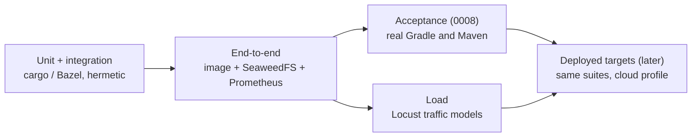
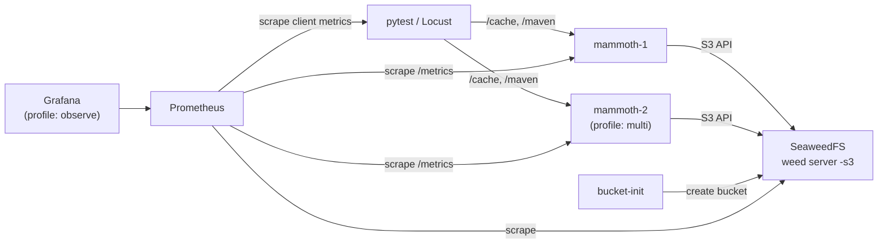

# 0011: End-to-end and load testing

## Status

Draft

## Summary

mammoth gets a non-hermetic test stage that runs the real container image against a real
S3-compatible bucket (SeaweedFS) and a Prometheus server, all started with Docker Compose. A typed
Python harness (uv, pytest, ruff, pyrefly) drives it: it holds the HTTP clients, the `/metrics`
parser, the bucket inspector and the stack lifecycle. The same harness runs the real-client
acceptance suite from [0008](0008-supported-clients.md). Load and traffic simulation use Locust,
whose client-side numbers Prometheus scrapes next to mammoth's. Every suite reads its target from a
profile, so the tests that run against Compose today can run against a deployed cluster later.

## Context and scope

The unit and integration tests in `crates/` are hermetic: they run in one process, with the bucket
tier on `object_store`'s in-memory or local-file backends. They cannot show that the shipped image
starts with a real `mammoth.toml`, talks to a real S3 API, survives a restart by refilling from the
bucket, or holds its latency under concurrent load.

[0008](0008-supported-clients.md) already specifies an acceptance suite that runs real Gradle and
Maven builds against `mammoth`, in `tests/acceptance/` with an `acceptance.yml` workflow. It covers
client compatibility. This doc adds the deployment-shaped tests next to it and gives both suites one
harness. [0009](0009-releases.md) builds the images under test: the from-source `Dockerfile` and
the `edge` and release images on ghcr.

This doc covers the test stages after the hermetic ones, the harness, the Compose stack, the load
framework, targets and CI. A Helm chart stays out of scope, as 0009 decided.

## Goals and non-goals

### Goals

- Test the artifact users run, the container image, not a binary built inside the test.
- Exercise all three tiers against real infrastructure: memory, disk and an S3 bucket.
- Cover what only a running deployment can show: restart and refill, several nodes on one bucket,
  the bucket going away, auth and limits end to end, metrics as Prometheus sees them.
- One Python harness for the end-to-end and acceptance suites, written to current Python practice:
  locked dependencies, strict types, one linter and formatter.
- A load and traffic-simulation framework that can find regressions in CI and give real numbers on
  real hardware later.
- Targets as configuration: the same suites run against Compose now and a deployed cluster later.

### Non-goals

- Replacing the hermetic Rust tests. Logic is tested there; this stage tests wiring and behaviour.
- Benchmark numbers now. The framework lands now; baselines come once the tiers are built.
- A Helm chart or Kubernetes manifests (see [Alternatives considered](#alternatives-considered)).
- Running these suites under Bazel. They need Docker and the network, so they are not hermetic.
- Chaos testing beyond what the scenarios below name.

## Design objectives and constraints

In priority order:

1. Failures are real. A red run means mammoth or its packaging is broken, not the harness.
2. Fast feedback on pull requests: the end-to-end suite runs in a few minutes on a hosted runner.
3. The harness is a small, typed library that test authors trust and extend.
4. Everything runs on a laptop with Docker and on GitHub-hosted Linux runners with no secrets.

## Design

### Test stages



| Stage        | Runs against                     | When                                         | Gate              |
| ------------ | -------------------------------- | -------------------------------------------- | ----------------- |
| Unit         | Code in-process                  | Every PR                                     | Required          |
| End-to-end   | Image on Compose                 | PRs touching code, image, stack or harness   | Required          |
| Acceptance   | Image on Compose + real clients  | PRs as in 0008; nightly full matrix          | Required on paths |
| Load smoke   | Image on Compose                 | PRs touching code or `tests/load/`           | Advisory          |
| Load full    | Image on Compose or a target     | Nightly and on demand                        | Advisory          |

### Layout

```text
deploy/compose/
  compose.yaml            mammoth, seaweedfs, bucket-init, prometheus; grafana under a profile
  mammoth.toml            test config: all three tiers, one user per scope
  prometheus.yml          scrapes mammoth, seaweedfs and a Locust run on the host
  grafana/                provisioned datasource and dashboard (profile "observe")
tests/
  pyproject.toml          one uv project for the harness and both Python suites
  uv.lock
  src/mammoth_e2e/        the harness library
  e2e/                    end-to-end suite
  acceptance/             the 0008 suite and its Gradle and Maven fixture projects
  load/                   locustfile: simulated clients, run shapes, thresholds
  targets/                target profiles: compose.toml, and later cloud ones
```

`deploy/compose/` is also a working example for users who want to try mammoth with a bucket.

### Compose stack



- **mammoth** runs the image named by `MAMMOTH_IMAGE`, defaulting to a local tag that CI builds
  from `Dockerfile`. Pointing it at `ghcr.io/nevzheng/mammoth-cache:edge` or a release tag tests
  published images unchanged. Once the config loader lands, its `mammoth.toml` sets `[bucket]
  endpoint` to SeaweedFS and keeps memory and disk small, so the tests can force evictions and fall
  through to the bucket.
- **SeaweedFS** runs as one `weed server -s3` container with a static test key pair in its S3
  config. It is Apache-2.0, small, and exposes its own Prometheus metrics.
- **bucket-init** is a one-shot container that creates the bucket and exits. mammoth depends on it
  with `condition: service_completed_successfully`.
- **Prometheus** scrapes every mammoth node and SeaweedFS every second, and the Locust exporter on
  the host (`host.docker.internal:9646`) during a load run. mammoth's metrics stay raw, as
  [0004](0004-metrics.md) requires: rates, ratios and percentiles are computed by Prometheus here,
  never by the node. Running it in tests also checks that a real Prometheus can scrape and parse
  `/metrics`.
- **Grafana** is under the `observe` profile, off in CI. Locally, `docker compose --profile observe
  up` gives a provisioned dashboard for poking at the stack and watching load runs.
- **mammoth-2** is under the `multi` profile, for the shared-bucket scenarios.
- **nginx** fronts `mammoth-proxied`, a node whose entry limit is 128 MiB, on two ports: 8080 with
  the settings the deployment guide gives (`client_max_body_size 0`, no request buffering, 300 s
  timeouts) and 8081 on nginx's defaults. It checks the proxy settings from
  [0013](0013-deployment.md).

SeaweedFS and Prometheus have health checks, and the harness runs `docker compose up --wait`. The
mammoth image is distroless, with no shell or `curl` for an in-container check, so the harness then
polls `/readyz` from the host.

### The harness

`mammoth_e2e` is the library every Python suite imports. It is small and fully typed.

| Module    | Provides                                                                                    |
| --------- | ------------------------------------------------------------------------------------------- |
| `target`  | Loads a target profile into a frozen, validated settings object                             |
| `stack`   | Compose lifecycle: up, down, restart or stop a service, wipe a node's disk, logs on failure |
| `client`  | Gradle `/cache/{key}` and Maven `/maven/{path}` clients over httpx, with auth helpers       |
| `metrics` | Scrapes `/metrics`, parses it, and gives counter deltas between two scrapes                 |
| `bucket`  | Lists, reads and deletes objects in the bucket, to assert what reached L3                   |
| `prom`    | Queries the Prometheus HTTP API, for load assertions and scrape checks                      |
| `blobs`   | Deterministic entry generators: keys, sizes, payloads from a seed                           |
| `builds`  | Copies the Gradle and Maven fixtures, salts them for fresh keys, runs builds, parses output |
| `versions`| Resolves a client line (`7.6`, `9`, `latest`) to its newest release at run time             |
| `tools`   | Downloads and caches Gradle and Maven distributions, so runners need only Java and Docker   |

pytest fixtures in `tests/conftest.py` expose these. The stack is session-scoped: it comes up once,
and tests isolate themselves with unique keys rather than restarts. Tests that stop or restart a
service carry the `control` marker and put the service back before they finish.

Assertions use counter deltas from `/metrics` and objects in the bucket, never log wording. When a
test fails, the harness attaches the recent logs of every service to the report.

### Python practice

The harness follows current Python practice. Every tool below runs in CI and in the repository's
prek hooks.

| Concern          | Choice                                                                                                                 |
| ---------------- | ---------------------------------------------------------------------------------------------------------------------- |
| Python           | 3.14, pinned in `.python-version`; `requires-python = ">=3.14"`                                                        |
| Project and lock | uv: `pyproject.toml` (PEP 621), `uv.lock`, dependency groups (PEP 735), `uv run`                                       |
| Lint and format  | ruff, with a broad rule set (`select = ["ALL"]` minus a short, commented ignore list)                                  |
| Type checking    | pyrefly in strict mode, configured in `[tool.pyrefly]`; no untyped defs, no `Any` leaks                                |
| Tests            | pytest with `--strict-markers`, `--strict-config` and pytest-timeout; one stack per run, parallel across the CI matrix |
| HTTP             | httpx, sync for tests; async only where a test needs concurrency                                                       |
| Settings         | pydantic-settings: target profiles from TOML, overridable by `MAMMOTH_E2E_*` env vars                                  |
| S3               | boto3 with `types-boto3` stubs, so pyrefly checks bucket calls                                                         |
| Metrics parsing  | `prometheus_client.parser`                                                                                             |
| Property tests   | Hypothesis, for key, path and size edge cases against the live server                                                  |
| Layout           | `src/` layout, a `py.typed` marker, frozen dataclasses for values                                                      |

CI checks that `uv.lock` is current with `uv lock --check`. Dependabot (or Renovate) updates it.

### Scenarios

The end-to-end suite covers what 0008's acceptance suite does not. The acceptance suite keeps its
scenario table, runs it for Gradle, Maven and Bazel (doc 0012), and moves onto the shared harness.

| Scenario             | Steps                                                                          | Expect                                                                    |
| -------------------- | ------------------------------------------------------------------------------ | ------------------------------------------------------------------------- |
| Image boots          | Start the stack                                                                | `/readyz` 200, `/ping` 200, Prometheus target up                          |
| Round trip           | PUT then GET Gradle and Maven entries of several sizes                         | Same bytes back; hit and store counters move                              |
| Write-through        | PUT, wait for `mammoth_bucket_upload_queue_entries` to hit 0                   | Object present in the bucket under the protocol's namespace               |
| Tier fall-through    | Fill past memory and disk sizes, GET the oldest entries                        | Served from the bucket; tier hit counters show L3                         |
| Refill after restart | Store entries, stop the node, wipe its disk volume, start it                   | Entries served from the bucket; disk refilled                             |
| Shared bucket        | Store on mammoth-1, GET from mammoth-2 (`multi` profile)                       | Hit on mammoth-2 via the bucket                                           |
| Bucket down          | Stop SeaweedFS, GET and PUT                                                    | Memory and disk keep serving; bucket errors counted; no 5xx on Gradle PUT |
| Bucket back          | Start SeaweedFS again                                                          | Queued or new uploads reach the bucket; the queue drains                  |
| Drain on SIGTERM     | Stream a slow PUT, send `SIGTERM` to the node mid-upload                       | `/readyz` 503 and `/livez` 200; new requests served; PUT 201; exit 0      |
| Large through proxy  | 100 MiB PUT through nginx with the documented settings, then on its defaults   | Stored and read back; on defaults nginx answers `413`, not mammoth        |
| Gradle write-once    | PUT the same key twice with different bodies                                   | First body kept                                                           |
| Maven overwrite      | PUT the same path twice                                                        | Second body served                                                        |
| Auth                 | Each user and scope, wrong token, anonymous                                    | Status codes and `WWW-Authenticate` as in 0002                            |
| Oversize             | Gradle and Maven PUT over the limit                                            | Gradle 200 and dropped; Maven 413; both counted                           |
| Metrics contract     | Scrape `/metrics`                                                              | `promtool check metrics` passes; every 0004 metric present                |
| Auth: happy paths    | Basic and Bearer for each user and scope; anonymous read on `mammoth-open`     | Round trips, reads, admin API as the scopes allow                         |
| Auth: refusals       | No, wrong or another user's token; missing scope; refused upload with `Expect` | `401` with `WWW-Authenticate` or `403`, AIP-193 reason; nothing stored    |
| Auth: hostile input  | Malformed and fuzzed `Authorization` headers, sent raw                         | Always `401`/`403`; never `5xx`; token never echoed                       |
| Protocol edge cases  | Racing stores, chunked and truncated uploads, bad keys and paths sent raw      | One winner; no partial entries; `400`, never `5xx`                        |
| Duplicate stores     | Re-store a present key, sending the body slowly                                | Answer only after the body is read, so pooled connections survive         |
| Bazel cache          | AC and CAS round trips, digest mismatch, bad digests, oversize                 | Per doc 0012: `201`/`200`, `400 DIGEST_MISMATCH`, `413`                   |

Tests that need a server feature that is not built yet carry `@pytest.mark.requires(...)` naming
it (`config`, `auth`, `disk`, `bucket`, `bazel`). The target profile lists the features it
has, and the tests for missing ones skip. The PR that builds a feature turns it on in
`targets/compose.toml`, so its tests start running in that PR. Known bugs are `xfail(strict=True)`
with the reason, so the fix turns them into a failure that asks for the marker to go.

### Load and traffic simulation

Locust is the load generator (decided by Nevin, 2026-10-14): the suites stay in one language and
share the harness, and Locust is the most widely used Python load tool.

- **Simulated clients.** `tests/load/locustfile.py` has one user class per protocol: a Gradle,
  Maven or Bazel client looks an entry up and stores it on a miss, as the build tools do. `--mix`
  weights the three (`8:1:1` by default). `FastHttpUser` keeps the per-request cost low.
- **Paced, not racing.** Each client runs at a fixed rate (`constant_throughput`), and the run's
  shape sets how many clients there are, so a run holds a request rate. Locust is still a closed
  model underneath: a client waits for its response before the next request, so when the node
  slows down, fewer requests are sent and tail latency reads low (coordinated omission). Runs keep
  enough clients for the rate to hold at the threshold's latency, and the server's own histograms
  in Prometheus are the honest tail.
- **Pass or fail.** `--max-p99-ms` and `--max-fail-ratio` (100 ms and 0.1% by default) make the run
  exit non-zero, which is what CI needs. A miss (`404`) counts as success.
- **Same store as the server.** The run serves Locust's counters and recent percentiles on
  `--metrics-port` (9646); Prometheus scrapes it next to mammoth, so one dashboard shows both
  sides. More throughput than one process gives comes from `--processes`.

Traffic models are Python in the harness (`mammoth_e2e.traffic`), seeded so every run asks for the
same keys and sizes. The synthetic model is built; the replay models come later:

| Model        | Shape                                                                                           |
| ------------ | ----------------------------------------------------------------------------------------------- |
| Synthetic    | Zipf-distributed keys, log-normal entry sizes, a configurable read/write mix                    |
| Build replay | Key, size and timing traces captured from acceptance runs (from mammoth's access log), replayed |
| CI fleet     | Many replay streams offset in time, to mimic a fleet of CI agents building the same repository  |

| Run         | Shape                                         | Where                       |
| ----------- | --------------------------------------------- | --------------------------- |
| Smoke       | 30 s at a low rate                            | PRs, advisory               |
| Steady      | Fixed rate per model for 10 minutes           | Nightly                     |
| Ramp        | Increase the rate until a threshold breaks    | On demand                   |
| Spike       | Short bursts over a steady baseline           | Nightly                     |
| Soak        | Steady rate for hours                         | On demand, real hardware    |
| Cold bucket | Wiped node, all reads fall through to L3      | Nightly                     |

Numbers from GitHub-hosted runners are noisy and only good for spotting large regressions, so load
runs there are advisory. Baselines that mean something come from dedicated hardware or a deployed
target, once the tiers are built.

### Targets

A target profile says where the system under test is and what the suites may do to it:

```toml
# tests/targets/compose.toml
name = "compose"
base_url = "http://localhost:5071"
prometheus_url = "http://localhost:9090"
features = [] # server features this target has; tests needing others skip
control = true # the harness may stop, restart and wipe services
destructive = true # tests may delete what they find in the bucket

[compose] # absent for targets the harness does not own
file = "../../deploy/compose/compose.yaml"
project = "mammoth-e2e"

[bucket]
name = "mammoth-e2e"
endpoint = "http://localhost:8333"
access_key_id = "mammoth-e2e"
secret_access_key = "mammoth-e2e-secret"

# [users.ci] test-only credentials, once auth lands
```

`pytest --target targets/compose.toml` and `locust --target targets/compose.toml` read the same
file. A later
`staging.toml` sets `control = false`, and the harness skips every test that needs control, so the
suites that only send traffic and read metrics run against a real deployment. Secrets for deployed
targets come from environment variables, never from the profile.

### CI

- **`image.yml`** (reusable): builds `Dockerfile` with Buildx and the GitHub Actions cache, and
  saves the image as an artifact for the jobs below.
- **`e2e.yml`:** a `python` job (`uv lock --check`, `ruff format --check`, `ruff check`, `pyrefly
  check`) and an `e2e` job that loads the image and runs `pytest e2e`. It runs on pull requests that
  touch the server, the image, `deploy/compose/` or `tests/`, on main and nightly.
- **`acceptance.yml`** (0008): one job per client line (Gradle 7.6, 8.14, 9; the Maven extension's
  1.2 line and latest release on Maven 3.9), on Java 17, with downloaded distributions cached. It
  runs on the same pull requests plus `api/`, and nightly, which picks up new patch releases.
- **`load.yml`** (later): the smoke run on pull requests, advisory, and the full runs nightly and on
  `workflow_dispatch` with a target and an image tag.

## Cross-cutting concerns

- **Security:** the stack uses static test credentials that exist only in the repository and
  grant access to nothing outside it. Deployed targets get credentials from CI secrets.
- **Cost:** the end-to-end job is a few minutes on a standard runner. The full load runs are
  nightly only.
- **Flakiness:** tests wait on health checks and on `mammoth_bucket_upload_queue_entries` reaching
  zero, never on sleeps.
  A test that flakes is fixed or deleted, never retried by default.
- **Observability:** every failing test attaches service logs; every load run leaves a Locust
  summary and, locally, a Grafana view.

## Alternatives considered

- **Helm chart on kind now.** Closer to production, but 0009 leaves the chart to its own doc, and
  kind adds minutes and moving parts to every run. The target profiles let the suites run against a
  Helm deployment once the chart exists.
- **MinIO.** The usual S3 stand-in, but its community edition is now source-only with no published
  images, which makes it a poor base for CI. LocalStack's S3 is less faithful and its free tier is
  shrinking.
- **testcontainers-python.** Good for single containers. The stack is also a user-facing example,
  so one `compose.yaml` that both users and tests read is worth more than containers declared in
  Python.
- **k6.** Open-model executors avoid coordinated omission and one Go process drives high rates,
  but its scripts are JavaScript, a third language beside Rust and Python, and it cannot share
  the harness. The pacing and server-side histograms above cover most of the difference.
- **aiolocust.** The Locust team's asyncio rewrite; promising, but young next to Locust.
- **Gatling, vegeta, oha, goose.** Gatling is heavier to run; vegeta and oha are single-endpoint
  tools without scenarios; goose (Rust) fits the server's language but has a far smaller
  ecosystem and would not share the Python harness.
- **mypy or pyright instead of pyrefly.** Pyrefly is fast, has a strict mode, and is a good fit for
  a small greenfield codebase with no legacy configuration to carry.
- **Poetry or pip-tools.** uv covers the interpreter, the lockfile and running tools in one fast
  binary, and has become the default for new projects.

## Open questions

- Should load results be kept over time somewhere (a branch, an artifact store, a Prometheus with
  long retention) to plot trends, or are nightly artifacts enough for now?
- Which deployed target comes first, and who pays for it?
