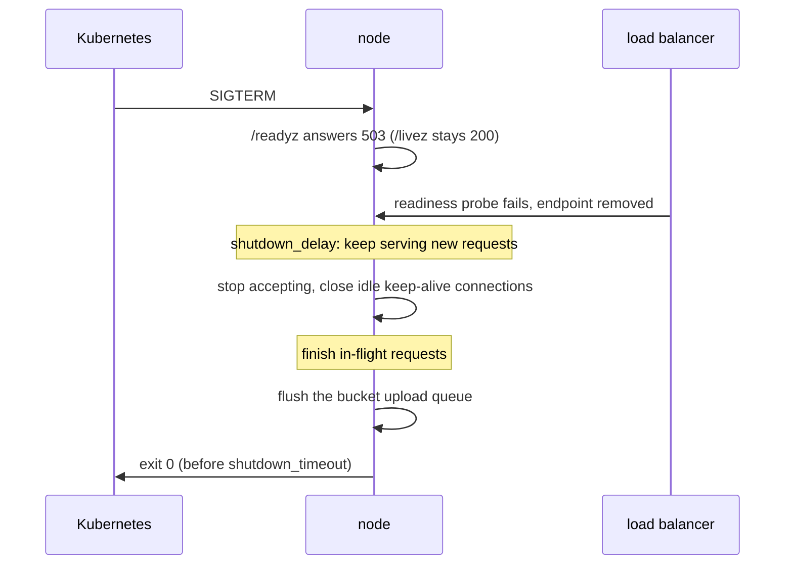

# 0013: Running behind load balancers and on Kubernetes

## Status

Draft

## Summary

mammoth-cache is meant to run as a few stateless nodes behind a load balancer, often on
Kubernetes. A readiness audit on 2026-10-14 found the shape right (one plain-HTTP port, health
routes, a distroless nonroot image, a config file that mounts from a Secret) but found gaps that
break real deployments: `SIGTERM` was ignored, there is no drain on shutdown, `/readyz` checks
nothing, there are no HTTP timeouts, and default proxy settings make Gradle turn its remote cache
off. This doc is the plan to close those gaps: what the server does on shutdown, what readiness
means, which timeouts it sets, what operators must configure in front of it, and who builds each
part.

## Context and scope

[0003](0003-architecture.md) makes nodes stateless and shares entries through an optional bucket.
[0001](0001-api-contracts.md) asks the server to "work with standard probes: Kubernetes, cloud load
balancers, Prometheus". The audit report (kept in the project files, not the repo) tested a build
of `main` at 5281a94:

- As PID 1 in a new PID namespace, as in the release image, `SIGTERM` was ignored: the process kept
  serving. Kubernetes waits `terminationGracePeriodSeconds` (30 s by default), then sends
  `SIGKILL`.
- As an ordinary process, `SIGTERM` killed it at once (exit 143), cutting in-flight uploads.
- A request whose headers arrived over 5 s was still served: no header-read timeout is set.

This doc covers the server's side (shutdown, readiness, timeouts, client addresses) and what the
operator sets up around it (proxies, routing, DNS, resources). It does not cover in-process TLS,
which stays a proxy's job for now, as [0005](0005-configuration.md) and the config loader say.

## Goals and non-goals

### Goals

- A rolling update or scale-in loses no accepted upload and fails no build.
- A node that cannot serve leaves rotation without being restarted.
- Work behind nginx, ingress-nginx, Traefik, Envoy (Istio, Gateway API), HAProxy, AWS ALB/NLB and
  Google Cloud load balancers with documented settings.
- Keep hit rate, the first objective in 0003, high with more than one replica.

### Non-goals

- A Helm chart or operator. One example set of manifests is enough for now.
- Service discovery or node-to-node traffic. Nodes stay independent.
- In-process TLS, HTTP/2 or h2c to the backend.
- A configurable path prefix (`base_path`). Serve the cache on its own host instead.

## Design objectives and constraints

In priority order:

1. **Never turn the client's cache off.** Gradle disables its remote cache for the build on any
   non-2xx store, `413` and `503` included. A shutdown or a proxy limit must not produce one.
2. **Lose nothing accepted.** A `200` to a `PUT` means the entry is stored, in every tier the node
   promised.
3. **Fit the platform's defaults.** Kubernetes gives 30 s to shut down; cloud LBs keep idle
   connections 60 s (AWS ALB) to 600 s (Google Cloud).
4. **Stay simple.** A few config keys with good defaults, no new dependencies beyond tokio and
   hyper features we already use.

## Design

### Shutdown

On `SIGTERM` or `SIGINT` the node drains in four steps:



1. **Fail readiness.** `/readyz` answers `503` with the check `shutting-down`, so kube-proxy,
   ingress controllers and cloud LBs stop sending new traffic. `/livez` stays `200` so the pod is
   not restarted mid-drain.
2. **Keep serving for `shutdown_delay`** (default 5 s). Endpoint removal is asynchronous; requests
   still arrive for a few seconds after `SIGTERM`, and refusing them fails builds. This replaces the
   usual `preStop: sleep` hook, which the distroless image cannot run (it has no `sleep`).
3. **Stop accepting and finish in-flight requests.** axum's graceful shutdown does this, but it
   waits for connections without limit, so the server wraps it in the shutdown deadline.
4. **Flush the bucket upload queue.** With `bucket.write = "async"`, entries waiting in the queue
   are uploaded before exit. Today they are dropped, so an `emptyDir` disk loses them for good.
   Uploads still queued when the deadline hits are dropped, logged and counted
   (`mammoth_bucket_uploads_dropped_total{reason="shutdown"}`). Those entries then live only on
   that node's disk; operators who cannot lose any use `bucket.write = "sync"`.

Steps 2 to 4 share one deadline, `shutdown_timeout` (default 25 s), kept below Kubernetes' 30 s so
the node exits on its own. A second signal exits at once.

### Readiness

`/readyz` keeps the format in [the user guide](../user/health.md). Its checks:

| Check                | Fails when                                                    |
| -------------------- | ------------------------------------------------------------- |
| `config`             | Never once serving (kept for the format)                      |
| `shutting-down`      | A shutdown signal arrived                                     |
| `storage-writable`   | The disk tier cannot create and remove a probe file           |
| `storage-free-space` | Free space on the disk tier is below `disk.free_space_buffer` |

The bucket is **not** a readiness check. A bucket outage should degrade every node to its local
tiers, not take every node out of rotation at once. Bucket health shows in metrics instead.

`disk.free_space_buffer` is parsed today but not enforced. The free-space check and refusing disk
writes below the buffer land together, so the node never reports ready while it cannot store.

Checks run in the background on an interval (for example 5 s) and the handler reads the cached
result, so probes cost nothing and a slow disk cannot time a probe out.

### Startup

The listener binds after the disk tier opens, and opening scans existing entries. With a large
disk, probes get connection refused for a while. That is correct (the node is not ready), but
operators need a `startupProbe` with a generous `failureThreshold`, documented in the guide.

### Timeouts

Set on the hyper connection builder. axum 0.8's `axum::serve` exposes neither a timer nor
`header_read_timeout`, so the server accepts connections itself and serves each with
`hyper_util::server::conn::auto::Builder` (`serve_connection_with_upgrades`):

| Setting               | Default | Why                                                                   |
| --------------------- | ------- | --------------------------------------------------------------------- |
| `header_read_timeout` | 30 s    | Bounds slow or stuck clients holding a connection before a request    |
| `idle_timeout`        | 75 s    | Closes idle keep-alive connections; must exceed the LB's idle timeout |
| `body_read_timeout`   | 60 s    | Per read, not total: aborts an upload that sends nothing this long    |

There is deliberately no total request timeout: a 100 MiB entry over a slow CI link is legitimate.
`idle_timeout` must be longer than the load balancer's, or the LB reuses a connection the server
has just closed and returns `502`. 75 s clears AWS ALB's 60 s and nginx's 60 s upstream keep-alive;
Google Cloud's 600 s needs it raised, which the guide says.

Accepted sockets also get `TCP_NODELAY`, which axum does not set, so small responses (`HEAD`
answers, misses) are not delayed by Nagle's algorithm.

### Client addresses

The access log (`log.access_log`) should show the client, not the load balancer. The server reads
`X-Forwarded-For` only from peers in `server.trusted_proxies` (CIDRs, empty by default, so the
header is ignored unless configured) and logs the right-most untrusted address. Nothing else uses
forwarded headers: the server builds no absolute URLs and sends no redirects.

### Configuration

A new `[server]` table for connection settings, added to [0005](0005-configuration.md) when it is
built. `listen` stays a top-level key, as today, for compatibility:

```toml
[server]
shutdown_delay = "5s"
shutdown_timeout = "25s"
header_read_timeout = "30s"
idle_timeout = "75s"
body_read_timeout = "60s"
trusted_proxies = [] # e.g. ["10.0.0.0/8"]
```

Validation: `shutdown_delay` below `shutdown_timeout`; every duration above zero.

### What operators set up

This part is documentation, in a new user guide page, `docs/user/deployment.md`.

**Proxy body size and timeouts.** Defaults that break Gradle:

| Proxy           | Default                         | Set                                                    |
| --------------- | ------------------------------- | ------------------------------------------------------ |
| nginx           | 1 MiB body limit, `413`         | `client_max_body_size 0;` (or above `max_entry_size`)  |
| ingress-nginx   | 1 MiB body limit, `413`         | `nginx.ingress.kubernetes.io/proxy-body-size: "0"`     |
| ingress-nginx   | Buffers the whole body to disk  | `proxy-request-buffering: "off"` (optional)            |
| ingress-nginx   | 60 s read and send timeouts     | `proxy-read-timeout` and `proxy-send-timeout: "300"`   |
| AWS ALB         | 60 s idle timeout               | Keep it below the server's `idle_timeout`              |
| Google Cloud LB | 30 s backend timeout            | `BackendConfig` `timeoutSec` above the longest upload  |
| Envoy / Istio   | Body-buffering filters cap size | Keep buffering filters off this route                  |

**Hit locality.** Each node has its own memory and disk tiers. Behind a round-robin Service, a new
entry hits only about one request in N (N replicas) until another node reads it from the bucket.
Two supported shapes:

- **Shared bucket.** Any node can serve any entry once uploaded. Simplest; `bucket.write = "sync"`
  removes the miss window at the cost of upload latency.
- **Consistent hashing on the path, plus the bucket.** ingress-nginx `upstream-hash-by:
  "$request_uri"`, Envoy or Istio `consistentHash` (ring hash or Maglev), HAProxy `balance uri`.
  Each key lands on one node, so the local tiers see every hit for it. A plain Kubernetes Service
  and most cloud load balancers cannot hash on the path. Rescaling moves about 1/N of keys, and the
  bucket refills them.

**DNS.** Nothing special. Nodes never talk to each other, so there is no headless Service, SRV
record or peer discovery. Clients need one stable name (an Ingress host, a load balancer record,
or `mammoth.<namespace>.svc` for runners in the cluster). Nodes need egress DNS for the bucket
endpoint and, on cloud, the credential endpoints.

**TLS.** Terminate at the ingress or load balancer. Serve the cache on its own host rather than a
path prefix, since routes are fixed at `/cache/` and `/maven/`.

**Resources.** `memory.size` plus allocator overhead and in-flight bodies must fit under the
container's memory limit, or the pod is OOM-killed; about 60-70 % of the limit is a safe start.
`disk.path` on a PersistentVolumeClaim (StatefulSet) keeps the disk tier warm across restarts; an
`emptyDir` works but starts cold. The root filesystem can be read-only.

**Config and credentials.** Mount `mammoth.toml` from a Secret, since it holds token hashes, and
point `MAMMOTH_CONFIG` at it. Changes need a rollout. Bucket credentials come from the default
chains, so IRSA or EKS Pod Identity, GKE Workload Identity and Azure Workload Identity need no keys
in the file.

**Metrics.** `/metrics` shares the cache port. If the cache is exposed through an Ingress, block
`/metrics` there or set `metrics.require_auth`.

## Plan

| Step | Change                                                             | Owner            | State           |
| ---- | ------------------------------------------------------------------ | ---------------- | --------------- |
| 1    | Handle `SIGTERM`                                                   | Framework thread | PR #33          |
| 2    | Drain: readiness `503`, `shutdown_delay`, deadline, flush uploads  | Framework thread | Proposed        |
| 3    | Readiness checks, and enforce `free_space_buffer` on writes        | Framework thread | Proposed        |
| 4    | Timeouts and `TCP_NODELAY`, `[server]` config, update 0005         | Framework thread | Proposed        |
| 5    | `docs/user/deployment.md`: proxies, hit locality, DNS, TLS, sizing | Docs thread      | Proposed        |
| 6    | Update `docs/user/health.md` probes (`startupProbe`, drain)        | Docs thread      | Proposed        |
| 7    | E2E: `SIGTERM` during an upload; 100 MiB `PUT` through nginx       | E2E thread       | Proposed        |
| 8    | Example manifests in `deploy/kubernetes/`                          | Nevin to decide  | Proposed        |
| 9    | `X-Forwarded-For` in the access log with `trusted_proxies`         | Framework thread | With access log |

Steps 2 to 4 can ship as one PR; 5 and 6 can start now, marking server behaviour "Planned" until
it lands. Step 7 runs against each server change.

## Cross-cutting concerns

- **Observability.** A `mammoth_shutting_down` gauge and the `reason="shutdown"` drop counter make
  drains visible. Readiness failures are logged once per state change, not per probe.
- **Security.** Header and body idle timeouts limit slow-client resource holding. Forwarded headers
  are ignored unless `trusted_proxies` is set, so clients cannot spoof their address in the log.
- **Testing.** The drain is testable in-process (send the signal future, assert `/readyz` turns
  `503` and an in-flight `PUT` completes) and end to end in the E2E suite.

## Alternatives considered

- **`preStop` hook instead of `shutdown_delay`.** Needs a `sleep` binary (none in distroless) or
  Kubernetes 1.30+'s `preStop.sleep`, and does nothing outside Kubernetes. The in-process delay
  works everywhere; operators on new clusters may use either.
- **Bucket in readiness.** Rejected: one bucket outage would remove every node at once.
- **A total request timeout.** Rejected: it fails legitimate large uploads on slow links.
- **Sticky sessions instead of path hashing.** Rejected: affinity by client keeps each client on one
  node, which spreads every key over every node, the opposite of what the cache needs.
- **`base_path` option.** Rejected for now: a dedicated host is simpler and every ingress supports
  one.

## Open questions

- Should `shutdown_delay` default to 0 when not running under Kubernetes? Detecting that is fragile;
  5 s on every `docker stop` seems acceptable.
- Should the node warn at startup when `memory.size` exceeds the cgroup memory limit? Cheap to add,
  but reading cgroup files is platform-specific.
