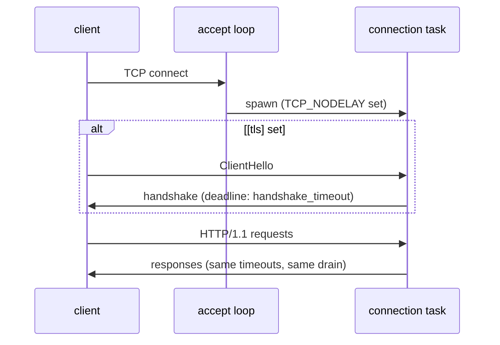

# 0014: Optional built-in TLS

## Status

Accepted

## Summary

mammoth-cache serves plain HTTP and relies on a proxy to terminate TLS. This doc adds an optional
`[tls]` table with two keys, a PEM certificate chain and a PEM private key. When it is present the
node serves HTTPS on its one port, using rustls, and picks up a renewed certificate from disk
without a restart. When it is absent nothing changes. Plain HTTP behind an ingress stays the
default and the recommended setup on Kubernetes ([0013](0013-deployment.md)).

## Context and scope

The node's credentials are Basic auth tokens ([0002](0002-authentication.md)), so they must travel
over TLS. Today that needs a second component in front of every secure deployment. On Kubernetes
the ingress is already there, but the ingress-to-pod hop is still plain text, which is fine on a
trusted network (a NetworkPolicy, or a service mesh's mTLS) and not otherwise. On a single VM there
is no ingress, so the choice is to run nginx or Caddy next to the node, or to send tokens in the
clear.

The Build Cache Node served TLS itself from `conf/ssl.crt` and `conf/ssl.key`. Design doc
[0005](0005-configuration.md) already maps those to `tls.cert` and `tls.key` in its migration
table, and documents the `[tls]` table, but the config loader rejects it ("not supported yet"), so
a migrating BCN user hits an error on the one setting they expect to carry over.

0005 also said certificate rotation is handled by restarting the node, and left reload as an open
question. This doc answers it: reload, by polling the files. It covers the server side, config
keys, certificate reload, metrics and tests. Client setup goes in the user guide.

### What's the point

The project aims to be the most flexible cache that is still as simple as possible. Built-in TLS
earns its place against that bar for four reasons:

- **One binary is a complete, secure deployment.** A small team on one VM runs `mammoth` with a
  certificate and is done. Without it, the simplest secure setup is two programs and two configs.
- **Drop-in parity.** BCN users had it. The migration table promises it.
- **Encryption to the pod.** Clusters that require encryption in transit everywhere, without a
  mesh, can re-encrypt from the ingress to the node.
- **It is cheap.** rustls, tokio-rustls and the aws-lc-rs crypto provider are already compiled into
  the binary through `object_store`'s HTTP client, so there are no new runtime dependencies. The
  code is a few hundred lines, there are two config keys, and nothing runs when the table is absent.

What would not earn its place is the rest of a TLS terminator: ACME, SNI with several
certificates, cipher and version knobs, HTTP to HTTPS redirects. Each adds config, state or ports
for a job a proxy already does well, so they stay non-goals. If someone needs them, they want a
proxy.

## Goals and non-goals

### Goals

- Serve HTTPS on `listen` when `[tls]` is set, plain HTTP when it is not.
- Pick up a renewed certificate and key without a restart and without dropping connections.
- Never start, or switch to, a certificate and key that do not match.
- Secure defaults with no knobs: TLS 1.2 and 1.3 only, rustls's default cipher suites.
- Keep every existing behaviour (timeouts, drain, health, metrics) the same over TLS.

### Non-goals

- Mutual TLS (client certificates). Clients authenticate with Basic auth tokens
  ([0002](0002-authentication.md)); a proxy can add client certificates for anyone who needs them.
- ACME or Let's Encrypt. It needs a public name, an HTTP-01 or TLS-ALPN-01 challenge path, account
  state and rate-limit handling.
- Several certificates (SNI), or serving HTTP and HTTPS at once on two ports.
- Redirecting HTTP to HTTPS.
- HTTP/2. The server is HTTP/1.1 only ([0013](0013-deployment.md)); ALPN offers `http/1.1`.
- Encrypted private keys, PKCS#12 bundles, or keys in an HSM or KMS.
- Configurable TLS versions or cipher suites.
- A FIPS-validated build. aws-lc-rs has a FIPS mode, so this stays possible later behind a Cargo
  feature.

## Design objectives and constraints

In priority order:

1. **Off means untouched.** Without `[tls]` the accept path, dependencies and performance do not
   change.
2. **Never serve a broken certificate.** Bad files fail startup; a bad renewal keeps the old one.
3. **Simple.** Two keys, no tuning. Matches the static-config rule in 0005: the file is still read
   once and never rewritten; only the files it points at are re-read.
4. **Work with how certificates are rotated:** cert-manager updating a mounted Secret (an atomic
   symlink swap), certbot rewriting files on a VM, and someone copying files by hand.

## Design

### Configuration

```toml
[tls] # optional; omit to serve plain HTTP, e.g. behind a TLS-terminating proxy
cert = "/etc/mammoth/tls.crt" # PEM: the server certificate, then any intermediates
key = "/etc/mammoth/tls.key"  # PEM: PKCS#8, PKCS#1 (RSA) or SEC1 (EC), unencrypted
```

Both keys are required when the table is present. The shape is the one 0005 already documents, so
0005 changes only to drop "rejected until built" and to replace its restart-on-rotation paragraph
with a link here.

At startup the node reads both files and fails with a clear error, before binding, when:

- a file cannot be read (missing, or not readable by the node's user, uid 65532 in the image);
- the certificate file has no `CERTIFICATE` block, or the key file has no private key;
- the key does not match the leaf certificate (rustls `CertifiedKey::keys_match`).

An expired certificate is not a startup error: refusing to start turns a renewal problem into an
outage. The node logs a warning instead (see Observability).

Key types are whatever the aws-lc-rs provider supports: RSA, ECDSA P-256 and P-384, and Ed25519.

### Accepting connections

The server already accepts connections itself and serves each with hyper (0013, PR #39). TLS adds
one step between `accept` and `serve_connection`:



- **The handshake runs in the connection's task, not the accept loop**, so a client that connects
  and sends nothing cannot stall other accepts.
- **The handshake has a deadline**, a fixed 10 s, not a config key. Without one, a silent client
  holds a socket and a task until the OS gives up. A failed or timed-out handshake closes the
  socket, counts in a metric and logs at debug level, since scanners and plain-HTTP clients cause
  them all day.
- **After the handshake nothing changes.** hyper serves the `tokio_rustls::server::TlsStream`
  exactly as it serves a `TcpStream`, so the header and idle timeouts, the body read timeout and
  graceful shutdown apply unchanged. Connections still mid-handshake when the node stops accepting
  are dropped with the listener's other unserved work.
- **One generic code path.** `accept` becomes generic over the stream type, so the plain and TLS
  paths share everything after the handshake. With `[tls]` absent no TLS code runs.
- ALPN advertises `http/1.1` only. A client that offers only `h2` fails the handshake rather than
  speaking HTTP/2 to an HTTP/1.1 server.

A plain-HTTP request to a TLS port fails the handshake and the connection closes. rustls cannot
answer it with an HTTP error, and sniffing the first byte to send a friendly `400` is not worth the
code.

### Reloading certificates

The node holds the current certificate in a `ResolvesServerCert` implementation backed by an
`RwLock<Arc<CertifiedKey>>`. Each new handshake clones the `Arc` under a read lock, which is cheap
next to the handshake itself; open connections keep the certificate they negotiated.

A background task re-reads both files every **60 s**. When their bytes differ from the last load,
it parses and checks them with the same rules as startup, then:

- on success, swaps in the new key, logs the new certificate's expiry at info level, and counts a
  successful reload;
- on failure, keeps serving the old certificate, logs the error at warn level, and counts a failed
  reload. It retries on the next tick, so a renewal that writes the certificate and the key one at
  a time settles once both files are written.

Polling rather than file notifications (inotify, `notify` crate) because Kubernetes updates a
mounted Secret by swapping a `..data` symlink, which notification watchers miss or see as a delete,
and polling works the same on every filesystem and platform. Reading two small files a minute costs
nothing. Certificates are renewed days or weeks before they expire (cert-manager defaults to a
third of the lifetime), and kubelet takes up to a minute or so to update a mounted Secret anyway,
so a 60 s poll adds no meaningful delay. The interval is a constant, not a config key.

Only the certificate and key reload. The rest of `mammoth.toml` is still read once.

### What the node guards, and what is the operator's job

The node guards only against mistakes that would otherwise become an outage it can see coming:

- **Refused at startup:** unreadable files, no certificate, no key, a key that does not match.
  Failing fast beats serving something no client can use.
- **Refused on reload:** the same checks. The old certificate keeps serving, so a botched renewal
  is a warning, not an outage.

Everything else is the operator's call, documented rather than enforced:

- **Expiry.** An expired certificate is served (refusing to start would turn a renewal problem into
  an outage). The node warns in the log within 14 days of expiry and exports the expiry as a gauge
  to alert on.
- **Names.** The node does not check that the certificate's names match the host clients use;
  clients do, and only the operator knows the name.
- **Trust.** Whether clients trust the issuing CA is set up on the clients.
- **Permissions.** The key file must be readable by the node's user, and should be readable by no
  one else.

### Self-signed certificates (`generate`)

Added for 0.1.0 (#87), for parity with the Build Cache Node's `--generate-self-signed-cert`: a
trial, a lab or a LAN node with no internal CA can serve HTTPS without the operator making a
certificate.

```toml
[tls]
cert = "/var/lib/mammoth/tls/tls.crt"
key = "/var/lib/mammoth/tls/tls.key"
generate = true                       # default false
hostnames = ["cache.lan", "10.0.0.5"] # optional; default: hostname, localhost, 127.0.0.1, ::1
```

- At startup, when **neither** file exists, the node writes a self-signed certificate and key to
  those paths, then loads them on the normal path. When both exist it loads them unchanged. When
  only one exists, startup fails: the pair can't be served, and overwriting the other half could
  destroy a key the operator meant to keep. `mammoth config check` applies the same rule and writes
  nothing.
- The files persist, so the certificate is stable across restarts and a client trusts it once.
  Regenerating is "delete both files and restart". Generating into memory only was rejected: a new
  certificate on every restart is one no client can trust.
- ECDSA P-256, valid 397 days from an hour before generation, CN `mammoth-cache`, a SAN for each
  hostname (IP addresses become IP SANs). Generated with `rcgen` on aws-lc-rs, the provider already
  linked, so no new crypto.
- Each file is written to a temporary file beside it and renamed, the key first and created `0600`,
  so a crash never leaves half a key.
- The node logs a warning at startup with the path and SHA-256 fingerprint, so an operator can
  check what they import. Expiry is covered by `mammoth_tls_certificate_expiry_seconds` and the
  14-day warning, like any certificate.
- Nothing after generation changes: serving, reload and the key/certificate check are the paths
  above. Still not doing: ACME, a private CA, or issuing client certificates.

### Things that change for operators

- **Probes.** Kubernetes probes need `scheme: HTTPS`; kubelet does not verify the certificate. Load
  balancer health checks need the HTTPS protocol.
- **Prometheus.** `/metrics` shares the port, so the scrape config needs `scheme: https` and a
  `tls_config` with the CA.
- **Clients.** Gradle, Maven and Bazel's HTTP cache all use the JVM trust store. A certificate from
  a public CA works as is; a private CA must be added to the trust store
  (`-Djavax.net.ssl.trustStore` or `keytool`). Gradle's `allowUntrustedServer = true` is for tests
  only.
- **Startup warning.** The warning that authentication is on over plain HTTP is not logged when
  `[tls]` is set.

The user guide's deployment page has a "TLS on the node" section with these.

## Cross-cutting concerns

### Performance

TLS 1.3 with aws-lc-rs adds one round trip per new connection and a little CPU per byte. Gradle,
Maven and Bazel keep connections alive, so handshakes are rare compared with requests. Session
resumption uses rustls's default in-memory session cache. Bodies stream through rustls the same way
they stream through TCP; there is no extra buffering. The Locust load suite (0011) gets a TLS
variant so the cost is measured, not assumed.

### Security

- TLS 1.2 and 1.3 only, rustls's default suites (no CBC, no RSA key exchange), no renegotiation,
  no compression.
- The key file is read and kept in memory; it is never logged, and the certificate holder's `Debug`
  output prints only the file paths. Loads and reloads log only the certificate's expiry.
- The handshake deadline limits slow-handshake resource holding, like the header timeout does for
  HTTP.
- The release image runs as uid 65532, so the key must be readable by it (on Kubernetes, the
  Secret volume's `defaultMode` or the pod's `fsGroup`).

### Observability

| Metric                                         | Type    | Meaning                                       |
| ---------------------------------------------- | ------- | --------------------------------------------- |
| `mammoth_tls_reloads_total{result}`            | counter | Certificate reloads, `result` = `ok`/`error`  |
| `mammoth_tls_handshake_failures_total{reason}` | counter | `timeout`, `error` (bad client, plain HTTP)   |
| `mammoth_tls_certificate_expiry_seconds`       | gauge   | `notAfter` of the serving certificate, Unix s |

The expiry gauge lets one Prometheus rule alert before a renewal problem becomes an outage. Reading
`notAfter` walks five DER elements of the certificate (RFC 5280, 4.1) in about 40 lines, rather
than adding an X.509 parser dependency. It feeds only the log and the gauge, never the decision to
serve a certificate.

### Testing

Three layers, each hermetic: certificates are generated by the test itself, so nothing is checked
in that expires, nothing calls the network, and no `openssl` binary is needed.

**Unit tests** (the `tls` module and `config.rs`), with certificates from `rcgen` (a dev
dependency):

- Each startup failure above gives its own clear error: missing file, empty PEM, a key where the
  certificate should be and the reverse, an encrypted key, a key that does not match.
- ECDSA and Ed25519 keys, and chains with intermediates.
- Reload: unchanged bytes do nothing; a certificate written before its key is refused, then swaps
  once the key follows; deleted files keep the current certificate.
- `notAfter` parsing for both DER time forms, across the 2049/2050 `UTCTime` boundary and leap
  days, and garbage input.
- Config: a `[tls]` table missing a key, or with an unknown key, is refused.

**Socket tests** (`crates/mammoth-cache/tests/tls.rs`, alongside `socket.rs` and `drain.rs`): a real
server on `127.0.0.1:0` with a generated CA and leaf, and a tokio-rustls client trusting that CA.
The handshake timeout and the reload interval are parameters, so tests set them to milliseconds.

- Gradle and Maven `PUT` and `GET` round trip over TLS with Basic auth, on one kept-alive
  connection.
- TLS 1.2 and TLS 1.3 are each served. Nothing older needs a test: rustls has no code for it.
- A plain-HTTP client against the TLS port never gets an HTTP response and is closed, and the
  server keeps serving others.
- A client that connects and sends nothing is closed after the handshake timeout, and other clients
  are served meanwhile.
- A client offering only `h2` fails; one offering `h2, http/1.1` gets `http/1.1`; one offering no
  ALPN is served.
- Reload: replace the files, and a new connection gets the new certificate while a connection
  opened before the swap keeps working; swap in a mismatched key, and new connections still get the
  old one. The watcher follows a Kubernetes-style `..data` symlink swap.
- Drain over TLS: an upload in flight at the shutdown signal completes after the listener closes.

These run under `cargo test` and as Bazel `rust_test` targets with no network and no external
binaries, so they are hermetic in both builds. `rcgen` comes in through Cargo's dev dependencies,
which crate_universe reads from `Cargo.lock` like any other.

**End to end** (owned by the E2E thread, `tests/e2e`, doc 0011): a `tls` Compose target where a
pytest fixture (Python `cryptography`) generates a CA and leaf into a volume before the stack
starts.

- Real Gradle and Maven builds against `https://` with the test CA imported into the JVM trust
  store: the second build hits the cache. Bazel `--remote_cache=https://` the same way.
- `curl --cacert` round trips, and a probe of `/readyz` over HTTPS.
- Rotation: overwrite the mounted files with a new leaf, wait one poll interval, and check the
  served certificate changed without a container restart and without failing a build running
  across the swap.
- A TLS scan of the running node (sslyze or testssl.sh) that fails on anything below TLS 1.2 or
  any weak suite, so the "secure defaults" claim is checked rather than asserted.
- A Locust load run against the TLS target next to the plain one, recorded rather than gated.

## Alternatives considered

- **Stay proxy-only.** Simplest code, but leaves single-VM users with two programs, breaks BCN
  migration, and leaves the ingress-to-pod hop in plain text without a mesh. Built-in TLS costs
  little because the crates are already in the binary.
- **OpenSSL (`openssl` or `tokio-native-tls`).** Links a system library, which the static musl
  build and distroless image avoid; rustls is already in the tree.
- **Restart on rotation, as 0005 said.** On Kubernetes it needs a third-party controller (Reloader)
  or a rollout per renewal; on a VM, a hook. Polling two files is less to set up and drops nothing.
- **File notifications (`notify`).** Fragile with Secret symlink swaps and network filesystems; see
  Reloading certificates.
- **Reload on `SIGHUP`.** Useful on a VM but not under Kubernetes, which cannot signal on a Secret
  change. Polling covers both.
- **Built-in ACME.** The most convenient for a public VM, but needs a public name, a challenge
  responder, account state and rate-limit handling. Caddy in front does it well.
- **An X.509 parser crate for the expiry.** `x509-parser` brings a parser stack for one date; the
  DER walk is small and tested.
- **A Cargo feature to leave TLS out.** It would save almost nothing, since `object_store` already
  links rustls, and every feature doubles a test matrix. TLS is always built in.

## Plan

| Step | Change                                                              | Owner      | State    |
| ---- | ------------------------------------------------------------------- | ---------- | -------- |
| 1    | This doc                                                            | TLS thread | PR #40   |
| 2    | `[tls]` loading and checks, TLS accept path, reload, metrics, tests | TLS thread | PR #40   |
| 3    | Update 0005 and the user guide (configuration, deployment, metrics) | TLS thread | PR #40   |
| 4    | E2E `tls` target: Gradle, Maven, Bazel, rotation, TLS scan, Locust  | E2E thread | Proposed |
| 5    | `[tls] generate`: a persisted self-signed certificate (#87)         | TLS thread | Done     |

## Open questions

None.
