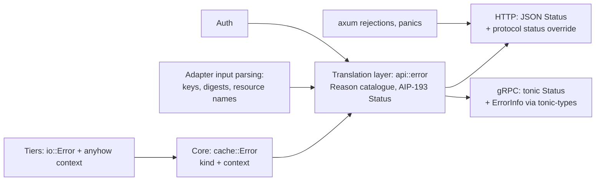

# 0017: Errors

## Status

Draft

## Summary

Inside, errors are coarse: the core and the tiers report a handful of kinds (`thiserror`) that
say what a caller can do about the failure, with the detail carried as `anyhow` context for the
logs. At the edge, a translation layer per port turns them into AIP-193: a stable `reason`, a
canonical `google.rpc.Code` and fixed metadata in the `mammoth-cache.dev` domain. The specific
reasons (`INVALID_DIGEST`, `OFFSET_OUT_OF_RANGE`) belong to the adapters that parse that input,
not to the core. One shared catalogue of reasons keeps HTTP and gRPC consistent. A protocol may
override the status code where its clients need it (Gradle on `/cache/`), never the reason.
Tests hold the catalogue, this doc, the OpenAPI specs and every adapter to each other.

## Context and scope

[0001](0001-api-contracts.md) set AIP-193 for every error body, with Gradle's status codes as the
one exception. [0016](0016-reapi-cache.md) added a gRPC surface with "the same reasons as HTTP
where they overlap". Both are honoured today, but by convention rather than by construction. This
doc audits what main does (as of `77f3a28`) and sets the structure that keeps it true as
protocols are added.

### What main does today

**Libraries.** No `anyhow` and no `thiserror`. Every error type hand-writes `Display` and
`std::error::Error`.

**Core.** `cache::CacheError` is the one error the core returns: `TooLarge { size, limit }`,
`Upload(io::Error)`, `Unavailable(io::Error)`, `Internal(io::Error)`. Tiers speak `io::Error`
through the `BlobStore` port, and `From<io::Error>` classifies by kind (`TimedOut` and
`WouldBlock` are `Unavailable`, the rest `Internal`) or by an `UploadFailed` marker that adapters
wrap their body errors in. Bucket outages never surface: the core turns them into misses. Other
typed errors: `key::InvalidKey`, `config::ConfigError`, `store::HealthCheck` problems (which
already carry an AIP reason such as `STORAGE_NOT_WRITABLE`).

**HTTP adapter** (`http/error.rs`). `ApiError` renders AIP-193 JSON with one `ErrorInfo`.
Constructors cover the common cases; `From<CacheError>` and `From<InvalidKey>` map core errors.
`/readyz` builds `ApiError::new` by hand. The `401` challenge is attached here.

**gRPC adapter** (`reapi/status.rs`). A second, independent mapping from `CacheError` to
`tonic::Status`, plus its own constructors in `reapi/services.rs` and `reapi/auth.rs`.

**Logging.** Both `From` mappings log as a side effect (`warn` for upload and unavailable, `error`
for internal), so the log level is chosen in two places.

### Gaps

| # | Gap                                                      | Where                                 |
| - | -------------------------------------------------------- | ------------------------------------- |
| 1 | The same core error gets different reasons per protocol: | `http/error.rs`, `reapi/status.rs`    |
|   | `Internal` is `INTERNAL` on HTTP and `STORAGE_ERROR` on  |                                       |
|   | gRPC; an unsupported method is `NOT_IMPLEMENTED` on HTTP |                                       |
|   | and `METHOD_NOT_SUPPORTED` on gRPC                       |                                       |
| 2 | Metadata keys differ: `ENTRY_TOO_LARGE` has              | same                                  |
|   | `maxEntryBytes`/`entryBytes` on HTTP and `limit` on      |                                       |
|   | gRPC; `ENTRY_NOT_FOUND` has `key`/`path`/`digest` on     |                                       |
|   | HTTP and `key` on gRPC                                   |                                       |
| 3 | The domain string is defined twice                       | `ERROR_DOMAIN`, `status::DOMAIN`      |
| 4 | No catalogue: reasons are string literals in five files, | `http/`, `reapi/`, `store/`           |
|   | so nothing checks they are documented, unique or stable  |                                       |
| 5 | axum's own rejections answer in plain text, not AIP-193: | `Path<String>`, `Query<_>` extractors |
|   | a `Path<String>` that is not UTF-8 after decoding        |                                       |
|   | (`/cache/%FF`), a malformed `/readyz` query (inferred    |                                       |
|   | from axum 0.8's rejection types, not yet reproduced)     |                                       |
| 6 | A panic in a handler drops the connection instead of     | no `CatchPanicLayer`                  |
|   | answering `500 INTERNAL`                                 |                                       |
| 7 | Logging lives inside the mappings, twice, with different | both `From` impls                     |
|   | levels for the same error (`debug` vs `warn` on upload)  |                                       |
| 8 | `405` sends canonical `UNIMPLEMENTED`, whose AIP-193     | `ApiError::method_not_allowed`        |
|   | status is `501`; not listed in 0001's exception table    |                                       |
| 9 | `ErrorInfo` reasons are pattern-checked by the OpenAPI   | `api/openapi/common.yaml`             |
|   | contract test (#38), but the set of reasons is not       |                                       |

None of these breaks a supported client today: Gradle, Maven and Bazel read status codes only.
They matter for operators, scripts and the next protocol.

## Goals and non-goals

### Goals

- A small, protocol-neutral error model in the core: few kinds, rich context, no wire concerns.
- Adapters render; they do not decide reasons. Status-code overrides are explicit, per protocol,
  and listed in one table.
- One catalogue of reasons with their code, metadata keys and default message. Adding a reason is
  one enum variant, and the build fails until every adapter and the doc handle it.
- Every error response on every surface is AIP-193, including framework rejections and panics.
- The same failure has the same reason and metadata on HTTP and gRPC.

### Non-goals

- Translated messages. Messages stay English; `reason` plus `metadata` is the stable,
  machine-readable key a client can translate from. `LocalizedMessage` stays allowed by the
  schema and unused.
- A specific error type per failure inside the core. A caller matches on what it can act on
  (retry, refuse, treat as a miss), and everything else is context.
- Changing what any supported client sees: status codes stay as they are.

## Design objectives and constraints

1. Clients first: no status code a build tool reads may change.
2. Exhaustive by construction: `match`, not string literals, so the compiler finds a missed case.
3. Cheap on the hot path: a miss is not an error and allocates nothing; reasons are `&'static str`.

## Design



### Core: few kinds, rich context

The core error says what a caller can do, not everything that went wrong:

```rust
/// Why a cache operation failed. Matched on by callers; the detail is in `source`.
#[derive(Debug, thiserror::Error)]
#[error("{kind}")]
pub struct Error {
    kind: ErrorKind,
    #[source]
    source: anyhow::Error, // "writing generation 7 of /var/cache/...: No space left on device"
}

#[derive(Clone, Copy, Debug, PartialEq, Eq, thiserror::Error)]
pub enum ErrorKind {
    #[error("the entry is over the size limit")]
    TooLarge { size: Option<u64>, limit: u64 },
    #[error("the client's upload failed")]
    Upload,           // client reset, truncated, stalled, or its content failed a check
    #[error("storage is unavailable")]
    Unavailable,      // may pass: a timeout, a tier cooling down
    #[error("internal error")]
    Internal,         // a bug or an unexpected storage failure
}
```

That is the whole core vocabulary, and it already matches `CacheError` today; the change is the
shape. Tiers and the core attach detail with `anyhow::Context`
(`.context("renaming the temp file")`) instead of growing variants, and the kind is chosen once
where the failure is understood. A miss stays `Ok(None)`. An adapter that needs more than the kind,
such as the gRPC adapter telling a digest mismatch from a stalled upload, downcasts the source to
the error type it put there itself; the core never needs to know those types. This follows Google's
own Rust client libraries: `google-cloud-gax`'s `Error` is an opaque struct with a few predicates
(`is_timeout`, `is_exhausted`, ...) and a `status()` accessor for the AIP-193 payload, rather than a
public enum per failure.

`anyhow` is also right for startup: `main`, config loading and TLS setup report one message chain
and an exit code, and nothing matches on them. `thiserror` is for types that cross a boundary and
get matched: `ErrorKind`, `ConfigError`'s user-facing cases, the adapters' input errors.

### Translation layer: `api::error`

One module shared by the HTTP and gRPC adapters (not by the core) owns the external contract:

```rust
/// Stable AIP-193 reasons. Never renamed or reused.
#[derive(Clone, Copy, Debug, PartialEq, Eq)]
pub enum Reason { EntryNotFound, EntryTooLarge, DigestMismatch, UploadIncomplete, /* ... */ }

impl Reason {
    pub const ALL: &[Self] = &[/* every variant; a test checks the count */];
    pub const fn as_str(self) -> &'static str { /* exhaustive match */ }
    pub const fn code(self) -> Code { /* exhaustive match */ }
}

/// AIP-193 without the transport.
pub struct Status { reason: Reason, message: Cow<'static, str>, metadata: Vec<(&'static str, String)> }

pub const DOMAIN: &str = "mammoth-cache.dev";
```

`From<&cache::Error> for Status` maps the four kinds, once, for both protocols. Adapter-specific
reasons (`INVALID_DIGEST`, `INVALID_RESOURCE_NAME`, `OFFSET_OUT_OF_RANGE`) are built by the
adapter that parses that input, from the same catalogue, so they stay unique and documented
without leaking into the core. Metadata keys are camelCase and fixed per reason
(`ENTRY_TOO_LARGE` always has `maxEntryBytes` and, when known, `entryBytes`).

### Adapters: render and override

- **HTTP** keeps `ApiError` as the rendering of an `error::Status`. Its status code is
  `reason.code().http_status()` unless the route's protocol overrides it:

  | Protocol     | Reason               | AIP-193 | Sent  | Why                              |
  | ------------ | -------------------- | ------- | ----- | -------------------------------- |
  | Gradle       | `ENTRY_TOO_LARGE`    | `400`   | `413` | Under `Reject`; `Drop` sends 200 |
  | Maven, Bazel | `ENTRY_TOO_LARGE`    | `400`   | `413` | Clients log and carry on         |
  | all HTTP     | `METHOD_NOT_ALLOWED` | `501`   | `405` | HTTP semantics, with `Allow`     |
  | all HTTP     | `CREDENTIALS_*`      | `401`   | `401` | Adds the Basic challenge         |

  Gradle's accept-and-drop stays a success path in the handler, not an error.
- **gRPC** renders `code` directly and keeps `ENTRY_TOO_LARGE` as `INVALID_ARGUMENT` (0016:
  clients retry `RESOURCE_EXHAUSTED`). The `ErrorInfo` detail is built with `tonic-types`
  (`Status::with_error_details`), the gRPC richer-error-model helpers, in place of the hand-encoded
  `google.rpc` protos in `reapi/status.rs`.
- **Rejections and panics.** Handlers take a thin `Path` wrapper whose rejection is
  `INVALID_ARGUMENT` with the protocol's key reason, a `Query` wrapper likewise, and the router
  gets `CatchPanicLayer` rendering `500 INTERNAL`. A last-resort `map_response` layer rewrites any
  4xx/5xx without a JSON body, so a future gap degrades to a generic AIP-193 body rather than
  plain text.
- **Logging** happens once, where the response is rendered, at a level chosen by code: client
  errors at `debug`, `UNAVAILABLE` at `warn`, `INTERNAL` at `error` with the `source` chain.

### Catalogue

The catalogue is the `Reason` enum; this table is its documentation and a test keeps them equal.
The proposed resolutions of gaps 1 and 2 are in bold.

| Reason                        | Code                  | HTTP | Metadata                      |
| ----------------------------- | --------------------- | ---- | ----------------------------- |
| `ENTRY_NOT_FOUND`             | `NOT_FOUND`           | 404  | **`key`** (all protocols)     |
| `ROUTE_NOT_FOUND`             | `NOT_FOUND`           | 404  |                               |
| `ENTRY_TOO_LARGE`             | `INVALID_ARGUMENT`    | 413* | `maxEntryBytes`, `entryBytes` |
| `DIGEST_MISMATCH`             | `INVALID_ARGUMENT`    | 400  | `key`                         |
| `SIZE_MISMATCH`               | `INVALID_ARGUMENT`    | 400  | `key`                         |
| `UPLOAD_INCOMPLETE`           | `INVALID_ARGUMENT`    | 400  |                               |
| `UPLOAD_IDLE`                 | `DEADLINE_EXCEEDED`   | 504  |                               |
| `INVALID_CACHE_KEY`           | `INVALID_ARGUMENT`    | 400  |                               |
| `INVALID_CACHE_PATH`          | `INVALID_ARGUMENT`    | 400  |                               |
| `INVALID_DIGEST`              | `INVALID_ARGUMENT`    | 400  |                               |
| `INVALID_RESOURCE_NAME`       | `INVALID_ARGUMENT`    | 400  |                               |
| `INVALID_READ_LIMIT`          | `INVALID_ARGUMENT`    | 400  |                               |
| `INVALID_WRITE`               | `INVALID_ARGUMENT`    | 400  |                               |
| `OFFSET_OUT_OF_RANGE`         | `OUT_OF_RANGE`        | 400  |                               |
| `BATCH_TOO_LARGE`             | `INVALID_ARGUMENT`    | 400  |                               |
| `UNSUPPORTED_DIGEST_FUNCTION` | `INVALID_ARGUMENT`    | 400  |                               |
| `CREDENTIALS_MISSING`         | `UNAUTHENTICATED`     | 401  |                               |
| `CREDENTIALS_INVALID`         | `UNAUTHENTICATED`     | 401  |                               |
| `SCOPE_MISSING`               | `PERMISSION_DENIED`   | 403  | `user`, `requiredScope`       |
| `METHOD_NOT_ALLOWED`          | `UNIMPLEMENTED`       | 405* |                               |
| **`METHOD_NOT_SUPPORTED`**    | `UNIMPLEMENTED`       | 501  | `method` (replaces HTTP's     |
|                               |                       |      | `NOT_IMPLEMENTED`)            |
| `STORAGE_UNAVAILABLE`         | `UNAVAILABLE`         | 503  |                               |
| `STORAGE_NOT_WRITABLE`        | `UNAVAILABLE`         | 503  | `check`, tier details         |
| `STORAGE_FREE_SPACE_LOW`      | `UNAVAILABLE`         | 503  | `check`, tier details         |
| `SHUTTING_DOWN`               | `UNAVAILABLE`         | 503  | `check`                       |
| **`INTERNAL`**                | `INTERNAL`            | 500  | (replaces gRPC's              |
|                               |                       |      | `STORAGE_ERROR`)              |

`*` is a protocol override from the table above. Renaming the two gRPC-only reasons is allowed
now: the gRPC adapter has not shipped in a release.

## Testing

| Layer                | Test                                                                |
| -------------------- | ------------------------------------------------------------------- |
| Compile              | `Reason::code`, the HTTP override and both renderers are exhaustive |
|                      | `match`es with no `_` arm, so a new reason fails the build          |
| Unit                 | Catalogue test: every `Reason` (via `Reason::ALL`) is in this doc's |
|                      | table and in `api/openapi/common.yaml`, matches the reason pattern, |
|                      | and no two variants share a string                                  |
| Unit                 | Rendering: each reason's HTTP status, JSON body, gRPC code and      |
|                      | `ErrorInfo` detail; domain and metadata keys equal across both      |
| Proptest             | Arbitrary `CacheError`/`InvalidKey` render to the same reason and   |
|                      | metadata keys on HTTP and gRPC                                      |
| Router (extends #38) | Arbitrary paths, methods and queries (including `%FF`, `%00`, bad   |
|                      | query strings): every non-2xx body validates against `Status` in    |
|                      | `common.yaml`; a handler that panics answers `500 INTERNAL`         |
| E2E (Hypothesis)     | `ParityModel` also compares error reasons between `/bazel` HTTP and |
|                      | gRPC; existing models keep asserting no status code a client reads  |
|                      | has changed                                                         |
| Acceptance           | Unchanged: real Gradle, Maven and Bazel clients are the check that  |
|                      | overrides still hold                                                |

## Plan

Each step is one PR that keeps CI green.

1. This doc, as Draft. Review the catalogue and the two renames.
2. Core: `cache::Error` as kind plus `anyhow` context, `thiserror` on the error types, `anyhow`
   in `main` and config loading. No behaviour change.
3. Translation layer: `api::error` (`Reason`, `Code`, `Status`, `DOMAIN`) and the catalogue test.
   Both adapters render through it, which fixes gaps 1 to 4 and 7. No status code changes; the two
   gRPC reasons are renamed.
4. Rejections and panics: `Path`/`Query` wrappers, `CatchPanicLayer`, the fallback layer and the
   router fuzz test (gaps 5 and 6).
5. Parity: the proptest and the `ParityModel` reason check.
6. Mark this doc Accepted, add the `405` row to 0001's exception table (gap 8), and list the
   reasons in the user docs.

## Cross-cutting concerns

- **Performance.** Errors are off the hot path; a miss stays `Ok(None)`. `Reason` is `Copy`.
- **Security.** `source` chains are logged, never sent. Messages name no paths, hosts or tokens.
- **Observability.** Metrics keep their `outcome` labels; a `reason` label is not added (it would
  multiply series for little gain over logs).

## Alternatives considered

- **`anyhow` everywhere, no kinds.** Adapters would have to downcast to tell a timeout from a bug.
  The kind is the one thing a caller needs; `anyhow` carries the rest.
- **A specific core variant per failure** (`DiskFull`, `RenameFailed`, `BucketTimeout`, ...).
  Callers cannot act on the difference, every new failure becomes an API change, and the variants
  drift towards wire reasons. Detail belongs in context and logs.
- **Per-adapter error enums with no shared catalogue** (today). Works, but drifts, as gaps 1 and 2
  show.
- **Generate the catalogue from a proto enum.** More ceremony than one Rust enum and a doc test,
  for a list that changes rarely.

## Open questions

- None blocking. `anyhow` and `thiserror` are already in the lock file through dependencies;
  `tonic-types` is a new direct dependency from the tonic project.
