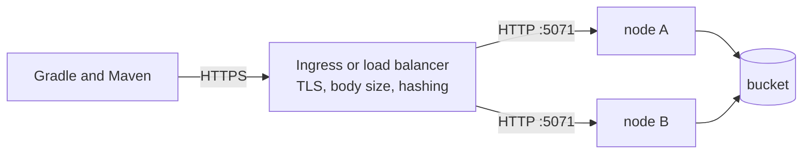

# Deployment

mammoth-cache is built to run as a few stateless nodes behind a load balancer, often on Kubernetes.
Each node serves plain HTTP on one port. The proxy in front terminates TLS and routes requests, and
an optional bucket shares entries between nodes. This page covers what to set up around the nodes.
Design doc [0013](../design/0013-deployment.md) has the reasoning. The project ships no Helm chart
or manifests: the snippets below are what to put in your own.



## Proxy settings

Gradle turns its remote cache off for the rest of the build after any failed store, `413`
included. Several proxies refuse or cut off large uploads by default, so check these first:

| Proxy           | Default                         | Set                                                    |
| --------------- | ------------------------------- | ------------------------------------------------------ |
| nginx           | 1 MiB body limit, `413`         | `client_max_body_size 0;` (or above `max_entry_size`)  |
| ingress-nginx   | 1 MiB body limit, `413`         | `nginx.ingress.kubernetes.io/proxy-body-size: "0"`     |
| ingress-nginx   | Buffers the whole body to disk  | `proxy-request-buffering: "off"` (optional)            |
| ingress-nginx   | 60 s read and send timeouts     | `proxy-read-timeout` and `proxy-send-timeout: "300"`   |
| AWS ALB         | 60 s idle timeout               | Keep it below the node's idle timeout (75 s)           |
| Google Cloud LB | 30 s backend timeout            | `BackendConfig` `timeoutSec` above the longest upload  |
| Envoy / Istio   | Body-buffering filters cap size | Keep buffering filters off this route                  |

For ingress-nginx, the annotations together, including the path hashing described next:

```yaml
metadata:
  annotations:
    nginx.ingress.kubernetes.io/proxy-body-size: "0"
    nginx.ingress.kubernetes.io/proxy-request-buffering: "off"
    nginx.ingress.kubernetes.io/proxy-read-timeout: "300"
    nginx.ingress.kubernetes.io/proxy-send-timeout: "300"
    nginx.ingress.kubernetes.io/upstream-hash-by: "$request_uri"
```

## Hit rate with several nodes

Each node has its own memory and disk tiers. Behind a round-robin Service, a new entry is a local
hit only on about one request in N (with N nodes) until another node fetches it from the bucket.
Two setups keep the hit rate up:

- **A shared bucket.** Any node can serve any entry once it is uploaded. This is the simplest
  setup. With `bucket.write = "sync"`, a store answers only after the upload, so there is no window
  where other nodes miss, at the cost of slower stores.
- **A shared bucket plus consistent hashing on the path.** Each key always lands on the same node,
  so that node's memory and disk see every hit for it. Use ingress-nginx
  `upstream-hash-by: "$request_uri"`, Envoy or Istio `consistentHash` (ring hash or Maglev), or
  HAProxy `balance uri`. Adding or removing a node moves about 1/N of the keys, and the bucket
  refills them.

A plain Kubernetes Service and most cloud load balancers can't hash on the path. Don't use sticky
sessions: they keep each client on one node, which spreads every key over every node.

## DNS

Nothing special. Nodes never talk to each other, so there's no headless Service, SRV record or peer
discovery. Clients need one stable name: an Ingress host, a load balancer record, or
`mammoth.<namespace>.svc` for CI runners in the same cluster. Nodes need outbound DNS for the bucket
endpoint and, on a cloud, for its credential endpoints.

## TLS

Terminate TLS at the ingress or load balancer; the node speaks plain HTTP and doesn't accept a
`[tls]` section yet. Serve the cache on its own host, such as `cache.example.com`, rather than under
a path prefix: routes are fixed at `/cache/` and `/maven/`. With authentication on, the node logs a
warning at startup as a reminder that tokens must not cross the network in clear.

## Memory and disk sizing

- **Memory.** `memory.size`, plus allocator overhead and bodies in flight, must fit under the
  container's memory limit, or the pod is OOM-killed. Start with `memory.size` at 60 to 70 % of the
  limit.
- **Disk.** Put `disk.path` on a PersistentVolumeClaim (a StatefulSet) to keep the disk tier warm
  across restarts: the node indexes the files already there when it starts. An `emptyDir` works too
  but starts cold. Set `disk.size` below the volume size, leaving room for `disk.free_space_buffer`.
- **Filesystem.** Only `disk.path` is written, so the root filesystem can be read-only.

## Config and credentials

Mount `mammoth.toml` from a Secret, since it holds token hashes, and point `MAMMOTH_CONFIG` at it.
A change to the file needs a rollout. Bucket credentials come from each cloud's default chain, so
IRSA or EKS Pod Identity, GKE Workload Identity and Azure Workload Identity work with no keys in the
file. The parts of a pod spec that matter:

```yaml
env:
  - name: MAMMOTH_CONFIG
    value: /etc/mammoth/mammoth.toml
resources:
  limits:
    memory: 3Gi # with memory.size = "2GiB"
securityContext:
  readOnlyRootFilesystem: true
volumeMounts:
  - name: config # a Secret holding mammoth.toml
    mountPath: /etc/mammoth
    readOnly: true
  - name: data # a PersistentVolumeClaim, or an emptyDir
    mountPath: /var/lib/mammoth
```

Probes are on [Health checks](health.md#kubernetes).

## Metrics

`/metrics` shares the cache port. If the cache is exposed through an Ingress, either block
`/metrics` there or set `metrics.require_auth = true` and give Prometheus its own token (see
[Metrics](metrics.md#scraping)). Inside the cluster, scrape the pods directly.

## Shutdown and timeouts

On `SIGTERM` the node drains in place of a `preStop` hook, which the distroless image can't run:
`/readyz` turns `503` while `/livez` stays `200`, it keeps serving for `shutdown_delay`, then it
stops accepting, finishes requests in flight, flushes the bucket upload queue and exits within
`shutdown_timeout`. Keep `terminationGracePeriodSeconds` above `shutdown_timeout`.

The settings are in the `[server]` section (see [Configuration](configuration.md#server)):

| Key                 | Default | Meaning                                                                        |
| ------------------- | ------- | ------------------------------------------------------------------------------ |
| `shutdown_delay`    | `5s`    | Keep serving after `SIGTERM` while load balancers remove the node              |
| `shutdown_timeout`  | `25s`   | Deadline for the whole drain; below Kubernetes' default 30 s                   |
| `idle_timeout`      | `75s`   | Close a connection that sends no request headers this long; above the LB's     |
| `body_read_timeout` | `60s`   | Abort an upload that sends nothing for this long (per read, not total)         |

`idle_timeout` also bounds how long a client may take to send request headers: hyper starts that
timer as soon as a keep-alive connection goes idle, so a shorter header timeout would close idle
connections before the load balancer does. `trusted_proxies`, for `X-Forwarded-For` in the access
log, comes with the access log.

There is deliberately no total request timeout, since a 100 MiB entry over a slow CI link is
legitimate. Behind a Google Cloud load balancer, whose idle timeout is 600 s, raise `idle_timeout`
above it.
