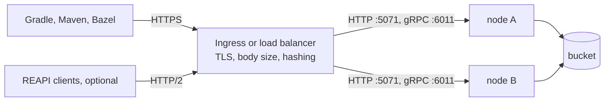

# Deployment

mammoth-cache is built to run as a few stateless nodes behind a load balancer, often on Kubernetes.
Each node serves one HTTP port (5071), plain HTTP by default, and with `protocols.reapi` on a
second, gRPC port (6011) for the [REAPI cache](reapi.md). The proxy in front terminates TLS and
routes requests, and an optional bucket shares entries between nodes. This page covers what to set
up around the nodes. Design doc [0013](../design/0013-deployment.md) has the reasoning. The project
ships no Helm chart or manifests: the snippets below are what to put in your own.



## Checklist

What a node needs to run well on Kubernetes, and where each part is covered:

| Need                                     | How                                                     | Status   |
| ---------------------------------------- | ------------------------------------------------------- | -------- |
| Keep serving when the bucket is down     | Local tiers answer; [Bucket outages](#bucket-outages)   | Done     |
| Exit cleanly on `SIGTERM`                | Built in                                                | Done     |
| Drain before exiting                     | [Shutdown and timeouts](#shutdown-and-timeouts)         | Done     |
| Liveness, readiness and startup probes   | [Health checks](health.md#kubernetes)                   | Done     |
| Readiness that checks the disk           | Writable and free-space checks every 5 s                | Done     |
| Stateless pods sharing entries           | A bucket; [Hit rate](#hit-rate-with-several-nodes)      | Done     |
| Large uploads through the proxy          | [Proxy settings](#proxy-settings)                       | Done     |
| Idle timeout above the load balancer's   | `server.idle_timeout`, 75 s by default                  | Done     |
| Config and token hashes from a Secret    | [Config and credentials](#config-and-credentials)       | Done     |
| Bucket access without keys               | [Bucket access](#bucket-access)                         | Done     |
| Non-root, read-only root filesystem      | The distroless image writes only `disk.path`            | Done     |
| Memory under the container limit         | [Memory and disk sizing](#memory-and-disk-sizing)       | Done     |
| `/metrics` not exposed publicly          | [Metrics](#metrics)                                     | Done     |
| TLS                                      | At the ingress, or [`[tls]` on the node](#tls)          | Done     |
| Access log with client addresses         | [Logs](logs.md#access-log) and `trusted_proxies`        | Done     |
| Helm chart or example manifests          | Not shipped; use the snippets on this page              | None     |

## Proxy settings

Gradle turns its remote cache off for the rest of the build after any failed store, `413`
included. Several proxies refuse or cut off large uploads by default, so check these first:

| Proxy           | Default                         | Set                                                    |
| --------------- | ------------------------------- | ------------------------------------------------------ |
| nginx           | 1 MiB body limit, `413`         | `client_max_body_size 0;` (or above `max_entry_size`)  |
| ingress-nginx   | 1 MiB body limit, `413`         | `nginx.ingress.kubernetes.io/proxy-body-size: "0"`     |
| ingress-nginx   | Buffers the whole body to disk  | `proxy-request-buffering: "off"` (optional)            |
| ingress-nginx   | 60 s read and send timeouts     | `proxy-read-timeout` and `proxy-send-timeout: "300"`   |
| AWS ALB         | 60 s idle timeout               | Keep it below the node's idle timeout (75 s)           |
| Google Cloud LB | 30 s backend timeout            | `BackendConfig` `timeoutSec` above the longest upload  |
| Envoy / Istio   | Body-buffering filters cap size | Keep buffering filters off this route                  |

For ingress-nginx, the annotations together, including the path hashing described next:

```yaml
metadata:
  annotations:
    nginx.ingress.kubernetes.io/proxy-body-size: "0"
    nginx.ingress.kubernetes.io/proxy-request-buffering: "off"
    nginx.ingress.kubernetes.io/proxy-read-timeout: "300"
    nginx.ingress.kubernetes.io/proxy-send-timeout: "300"
    nginx.ingress.kubernetes.io/upstream-hash-by: "$request_uri"
```

## Hit rate with several nodes

Each node has its own memory and disk tiers. Behind a round-robin Service, a new entry is a local
hit only on about one request in N (with N nodes) until another node fetches it from the bucket.
Two setups keep the hit rate up:

- **A shared bucket.** Any node can serve any entry once it is uploaded. This is the simplest
  setup. With `bucket.write = "sync"`, a store answers only after the upload, so there is no window
  where other nodes miss, at the cost of slower stores. A failed upload still answers success.
- **A shared bucket plus consistent hashing on the path.** Each key always lands on the same node,
  so that node's memory and disk see every hit for it. Use ingress-nginx
  `upstream-hash-by: "$request_uri"`, Envoy or Istio `consistentHash` (ring hash or Maglev), or
  HAProxy `balance uri`. Adding or removing a node moves about 1/N of the keys, and the bucket
  refills them.

A plain Kubernetes Service and most cloud load balancers can't hash on the path. Don't use sticky
sessions: they keep each client on one node, which spreads every key over every node.

## DNS

Nothing special. Nodes never talk to each other, so there's no headless Service, SRV record or peer
discovery. Clients need one stable name: an Ingress host, a load balancer record, or
`mammoth.<namespace>.svc` for CI runners in the same cluster. Nodes need outbound DNS for the bucket
endpoint and, on a cloud, for its credential endpoints.

## TLS

On Kubernetes, terminate TLS at the ingress or load balancer and serve plain HTTP to the pods. Serve
the cache on its own host, such as `cache.example.com`, rather than under a path prefix: routes are
fixed at `/cache/`, `/maven/` and `/bazel/`. With authentication on and no `[tls]`, the node logs a
warning at startup as a reminder that tokens must not cross the network in clear.

### TLS on the node

Set [`[tls]`](configuration.md#tls) to have the node serve HTTPS itself, with no proxy. Use it on
a single VM, or on a cluster that must encrypt the hop from the ingress to the pod without a
service mesh. Design doc [0014](../design/0014-tls.md) has the reasoning.

```toml
[tls]
cert = "/etc/mammoth/tls/tls.crt" # the certificate, then any intermediates
key = "/etc/mammoth/tls/tls.key"
```

- **Renewal.** The node re-reads both files every minute and serves a changed pair to new
  connections, with no restart. A pair that fails the checks (unreadable, or a key that doesn't
  match) is skipped and logged, and the old certificate keeps serving. This works with cert-manager
  updating a mounted Secret and with certbot rewriting files. With certbot, copy the renewed files
  into place from a deploy hook; the node must be able to read them as its own user (uid 65532 in
  the image).
- **Key permissions.** The node warns when the key file is readable by every user. Make it `0400`
  or `0600` for the node's own user. For a Kubernetes Secret volume, set `defaultMode: 0440` with
  `fsGroup: 65532`, so only the node's group can read it.
- **Probes and scrapes.** Probes need `scheme: HTTPS` (kubelet doesn't verify the certificate), load
  balancer health checks need the HTTPS protocol, and Prometheus needs `scheme: https` with a
  `tls_config` naming the CA.
- **Clients.** Gradle, Maven and Bazel trust what the JVM trusts. A certificate from a public CA
  works as is; for a private CA, import it into the JVM trust store (`keytool -importcert`) or point
  `javax.net.ssl.trustStore` at one.
- **What's not offered.** One port serves either HTTP or HTTPS, not both, and there are no client
  certificates, ACME, or TLS version or cipher settings: TLS 1.2 and 1.3 with rustls's defaults.
  Put a proxy in front for any of those.

### A self-signed certificate

For a trial, a lab or a LAN with no internal CA, let the node make its own certificate:

```toml
[tls]
cert = "/var/lib/mammoth/tls/tls.crt"
key = "/var/lib/mammoth/tls/tls.key"
generate = true
hostnames = ["cache.lan", "10.0.0.5"] # optional; defaults to the hostname, localhost and loopback
```

At startup, if neither file exists, the node writes a self-signed ECDSA P-256 certificate valid for
397 days, and its key readable by the node only. If both exist it loads them as usual, so the
certificate stays the same across restarts and clients only need to trust it once; put the paths
on a persistent volume (the disk tier's volume works). If only one exists, startup fails rather than
overwrite it. To make a new certificate, for new hostnames or when it nears expiry, delete both
files and restart. The node logs a warning at startup with the certificate's path and SHA-256
fingerprint, and `mammoth_tls_certificate_expiry_seconds` shows when it expires.

Clients refuse the certificate until they trust it. Copy the certificate file (never the key) to
each client, then either:

- **Import it into the JVM trust store** of every Gradle or Maven JVM. This keeps verification on:

  ```sh
  keytool -importcert -cacerts -storepass changeit -noprompt -alias mammoth-cache -file tls.crt
  ```

  Check the fingerprint `keytool -printcert -file tls.crt` prints against the node's log. For Bazel,
  pass `--tls_certificate=tls.crt`; for curl, `--cacert tls.crt`.
- **Or tell Gradle not to verify it**, with `allowUntrustedServer = true` on the remote cache in
  `settings.gradle(.kts)` (see [Gradle](gradle.md)). Anyone on the network path can then
  impersonate the node, so keep this to a trial.

## Memory and disk sizing

- **Memory.** `memory.size`, plus allocator overhead and bodies in flight, must fit under the
  container's memory limit, or the pod is OOM-killed. Start with `memory.size` at 60 to 70 % of the
  limit.
- **Disk.** Put `disk.path` on a PersistentVolumeClaim (a StatefulSet) to keep the disk tier warm
  across restarts: the node indexes the files already there when it starts. An `emptyDir` works too
  but starts cold. Set `disk.size = "max-available"` to use the volume less
  `disk.free_space_buffer`, or a size below that if the volume holds anything else.
  Each `disk.path` serves one process, and a second pod on the same volume fails to start. With a
  ReadWriteOnce volume, use a StatefulSet, or a Deployment with the `Recreate` strategy, so a
  rolling update doesn't start the new pod while the old one still holds the directory.
- **Filesystem.** Only `disk.path` is written, so the root filesystem can be read-only.

## Config and credentials

Every setting is in the [configuration reference](configuration.md), which ends with a full
example. Mount `mammoth.toml` from a Secret, since it holds token hashes, and point `MAMMOTH_CONFIG`
at it.
A change to the file needs a rollout. Bucket credentials never go in the file; see
[Bucket access](#bucket-access). The image runs as the nonroot user (UID and GID 65532), so give the
pod `fsGroup: 65532`, or a fresh PersistentVolumeClaim is owned by root and the node can't write
`disk.path`. The parts of a pod spec that matter:

```yaml
# Pod
securityContext:
  fsGroup: 65532
# Container
env:
  - name: MAMMOTH_CONFIG
    value: /etc/mammoth/mammoth.toml
ports:
  - name: http
    containerPort: 5071
  - name: grpc # only with protocols.reapi = true
    containerPort: 6011
resources:
  limits:
    memory: 3Gi # with memory.size = "2GiB"
securityContext:
  readOnlyRootFilesystem: true
volumeMounts:
  - name: config # a Secret holding mammoth.toml
    mountPath: /etc/mammoth
    readOnly: true
  - name: data # a PersistentVolumeClaim, or an emptyDir
    mountPath: /var/lib/mammoth
```

Probes are on [Health checks](health.md#kubernetes); they stay on the HTTP port, since both ports
open and close together. Give the gRPC port its own `Service` port, and route it through a
gRPC-aware balancer as [REAPI networking](reapi.md#networking-and-load-balancing) describes.

## Bucket access

The node finds bucket credentials in its environment, the way the cloud's own tools do, so the
config file names only the bucket. Give the node's identity read and write on the bucket's prefix:
it never lists or deletes. Pick the row for where the node runs:

| Where the node runs | Bucket            | How it gets access                                                         |
| ------------------- | ----------------- | -------------------------------------------------------------------------- |
| EKS                 | S3                | IRSA (`eks.amazonaws.com/role-arn` on the ServiceAccount) or Pod Identity  |
| ECS or EC2          | S3                | The task role or instance profile                                          |
| GKE                 | GCS               | Workload Identity on the Kubernetes ServiceAccount                         |
| Compute Engine      | GCS               | The VM's service account                                                   |
| AKS                 | Azure Blob        | Workload Identity (`azure.workload.identity/use: "true"` on the pod)       |
| Azure VM            | Azure Blob        | Managed identity                                                           |
| Anywhere else       | S3-compatible     | `AWS_ACCESS_KEY_ID` and `AWS_SECRET_ACCESS_KEY` from a Secret              |
| Anywhere else       | GCS               | A service account key file from a Secret, `GOOGLE_APPLICATION_CREDENTIALS` |
| Anywhere else       | Azure Blob        | `AZURE_STORAGE_ACCOUNT_KEY` or a SAS token from a Secret                   |

The permissions a node needs, on its prefix only:

| Cloud | Grant                                                                                    |
| ----- | ---------------------------------------------------------------------------------------- |
| AWS   | `s3:GetObject`, `s3:PutObject`, `s3:AbortMultipartUpload`; `s3:ListBucket` on the prefix |
| GCP   | `roles/storage.objectUser`, or `storage.objects.get` and `storage.objects.create`        |
| Azure | `Storage Blob Data Contributor`, scoped to the container                                 |

On S3, `s3:ListBucket` is what makes a missing entry answer `404` rather than `403`; the node never
lists, but without it every miss is logged as a bucket error. For a bucket in another AWS account,
let the IRSA role live in that account, or grant the node's role in the bucket policy. For MinIO,
SeaweedFS, Cloudflare R2 and other S3-compatible stores, set `bucket.endpoint`, and
`bucket.allow_http = true` if the endpoint is plain `http://`:

```toml
[bucket]
url = "s3://build-cache/mammoth"
endpoint = "http://seaweedfs:8333"
region = "us-east-1"
allow_http = true
```

Not supported: AWS profiles and SSO from `~/.aws/config`, and GCP federation from outside Google
Cloud (external-account files). Use keys from a Secret there. Entries are never deleted from the
bucket, so set a lifecycle rule to expire them, for example after 30 days.

## Bucket outages

A bucket outage degrades a node to its local tiers: bucket reads that fail or pass `bucket.timeout`
are misses, the bucket is skipped for `bucket.cooldown`, and `/readyz` stays ready, so builds keep
their cache. Details and the alert to set are on [Health checks](health.md#bucket-outages).

## Metrics

`/metrics` shares the cache port. If the cache is exposed through an Ingress, either block
`/metrics` there or set `metrics.require_auth = true` and give Prometheus its own token (see
[Metrics](metrics.md#scraping)). Inside the cluster, scrape the pods directly.

## Shutdown and timeouts

On `SIGTERM` the node drains in place of a `preStop` hook, which the distroless image can't run:
`/readyz` turns `503` while `/livez` stays `200`, it keeps serving for `shutdown_delay`, then it
stops accepting, finishes requests in flight, flushes the bucket upload queue and exits within
`shutdown_timeout`. The gRPC port drains on the same clock: after `shutdown_delay` it sends `GOAWAY`
so clients reconnect through the balancer to another node, and calls in flight finish within the
same `shutdown_timeout`. Keep `terminationGracePeriodSeconds` above `shutdown_timeout`.

The settings are in the `[server]` section (see [Configuration](configuration.md#server)):

| Key                 | Default | Meaning                                                                         |
| ------------------- | ------- | ------------------------------------------------------------------------------- |
| `shutdown_delay`    | `5s`    | Keep serving after `SIGTERM` while load balancers remove the node               |
| `shutdown_timeout`  | `25s`   | Deadline for the whole drain; below Kubernetes' default 30 s                    |
| `idle_timeout`      | `75s`   | Close a connection that sends no request headers this long; above the LB's      |
| `body_read_timeout` | `60s`   | Abort an upload that sends nothing for this long (per read, not total)          |
| `send_timeout`      | `60s`   | Close a connection whose client stops reading a response (per write, not total) |

`idle_timeout` also bounds how long a client may take to send request headers: hyper starts that
timer as soon as a keep-alive connection goes idle, so a shorter header timeout would close idle
connections before the load balancer does. Set `trusted_proxies` to the load balancers' addresses,
so the access log shows each client's address from `X-Forwarded-For` rather than the load
balancer's.

There is deliberately no total request timeout, since a 100 MiB entry over a slow CI link is
legitimate. Behind a Google Cloud load balancer, whose idle timeout is 600 s, raise `idle_timeout`
above it.
