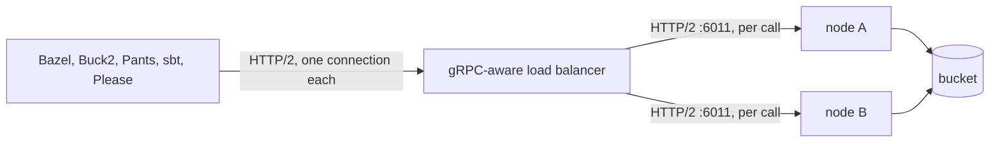

# REAPI gRPC cache

> [!NOTE]
> Off by default. Acceptance tests build with real Bazel (7, 8 and 9, also over `grpcs://`) and
> Buck2. The Pants, sbt 2 and Please settings below are not tested against those clients yet.

mammoth-cache serves the cache half of the
[Remote Execution API](https://github.com/bazelbuild/remote-apis) (REAPI v2) over gRPC:
`Capabilities`, `ActionCache`, `ContentAddressableStorage` and `ByteStream`. Build tools that only
speak REAPI, such as Buck2, Pants, sbt 2 and Please, can use it as a remote cache, and Bazel can use
it instead of the [HTTP cache](bazel.md). It does not serve `Execution`: actions always run on the
client's machine. mammoth-cache is a cache, not a remote build system. Design doc
[0016](../design/0016-reapi-cache.md) has the reasoning.

## Turn it on

```toml
[protocols]
reapi = true

[reapi]
listen = "[::]:6011" # the default; 6011 is the Build Cache Node's Bazel gRPC port
```

gRPC gets its own port, next to the HTTP port (5071), so turning it on changes nothing for Gradle
and Maven. With [`[tls]`](configuration.md#tls) set, both ports use the same certificate, and
clients use `grpcs://`; without it they use `grpc://`.

The gRPC cache and the [Bazel HTTP cache](bazel.md) share their entries: a blob or action result
stored over one is a hit over the other, so Bazel can move between them without a cold cache.

## Configure the client

Every client needs the cache address and, with [authentication](authentication.md) on, a token.
Reads need `cache:read` and uploads `cache:write`. A read-only token suits developer machines, but
tell the client not to upload, or every build logs `PERMISSION_DENIED` on each store: for Bazel,
`--noremote_upload_local_results`.

**Bazel**, in `.bazelrc`:

```text
build --remote_cache=grpcs://cache.example.com:6011
build --remote_header="Authorization=Bearer <token>"
```

A `--credential_helper` works as well. Leave `--remote_cache_compression` off: the node advertises
no compressors yet, so there is nothing for the flag to use. `--remote_download_minimal` (build
without the bytes) is safe: the node answers an action result as a miss when any output it lists has
been evicted, including any file inside an output directory. Each distinct `Tree` is read once, and
a lookup reads at most 4 MiB of trees and checks at most 10,000 distinct files in them; a tree past
either, or one that does not decode, is present but its files are not checked.

Unlike the HTTP cache, Bazel fails the build when it cannot reach a gRPC cache or its token is
refused ("Failed to query remote execution capabilities"), so keep the node behind a load balancer
with more than one replica. A token without `cache:write` only warns on each upload.

**Buck2**, in `.buckconfig`, with the execution platform set to run locally and use the remote
cache:

```ini
[buck2_re_client]
engine_address = grpcs://cache.example.com:6011
action_cache_address = grpcs://cache.example.com:6011
cas_address = grpcs://cache.example.com:6011
http_headers = Authorization: Bearer $MAMMOTH_TOKEN
```

**Pants**, in `pants.toml`:

```toml
[GLOBAL]
remote_cache_read = true
remote_cache_write = true
remote_store_address = "grpcs://cache.example.com:6011"
remote_store_headers = { Authorization = "Bearer <token>" }
```

**sbt 2**, in `build.sbt`:

```scala
Global / remoteCache := Some(uri("grpcs://cache.example.com:6011"))
```

with the token as a header in sbt's remote cache settings.

**Please**, in `.plzconfig`, with no remote executors so only the cache is used:

```ini
[Remote]
URL = cache.example.com:6011
Secure = true
```

Instance names are accepted and ignored: every instance shares one cache.

## Networking and load balancing

In short: a gRPC client opens one long-lived HTTP/2 connection to the cache and keeps it for the
whole build, sending every call over it. Your network and load balancer must support that. A
single node that clients reach directly needs none of this section.



What the path between client and node needs:

- **HTTP/2 end to end.** gRPC does not work over HTTP/1.1. Every proxy on the path must speak
  HTTP/2 to the client and to the node. A proxy that downgrades to HTTP/1.1, as many do by default,
  breaks every call.
- **A gRPC-aware (L7) balancer, so one connection's calls spread over every node.** Envoy,
  ingress-nginx with `nginx.ingress.kubernetes.io/backend-protocol: "GRPC"` (`"GRPCS"` with
  `[tls]` on the node), an AWS ALB target group with protocol version gRPC, or a Google Cloud load
  balancer with an HTTP/2 backend all balance each call. This is the recommended shape. Some cloud
  balancers only speak HTTP/2 to backends over TLS; turn on `[tls]` on the node for those.
- **Or a TCP (L4) balancer, accepting uneven load.** A Kubernetes `Service` of type `LoadBalancer`
  or an AWS NLB works with no gRPC settings, but it balances connections, not calls: each client
  sticks to the node it first reached for the whole build. Nodes are stateless and share the
  bucket, so this is correct, just less even, and a new node only gets new clients.
- **Idle timeouts longer than the keepalive.** The node pings each connection every 30 s and
  drops it if a ping goes unanswered for 20 s. Keep every idle timeout on the path (the load
  balancer's, a NAT gateway's, a firewall's) above 30 s, or the connection is cut between builds
  and the next call fails and retries. Clients can ping too, for example Bazel's
  `--grpc_keepalive_time=30s`.
- **Room for long calls.** Uploading or downloading a large blob is one call that can run for
  minutes. Raise request and stream timeouts on the balancer, and on ingress-nginx set
  `client_max_body_size` to `0` or above `limits.max_entry_size`.
- **Health checks on the HTTP port.** Use `/readyz` on the HTTP port for the gRPC backends too:
  both ports open and close together. On shutdown the node fails `/readyz`, then tells gRPC clients
  to reconnect elsewhere (`GOAWAY`) and lets calls in flight finish, within
  `server.shutdown_timeout`.

## With a separate remote executor

The node never runs actions. A remote executor (BuildBuddy, Buildbarn, NativeLink and others) has
its own CAS that its workers read inputs from, so point `--remote_executor` and `--remote_cache` at
the executor when you use one. Using mammoth-cache as the cache for an executor only works if that
executor is configured to use mammoth-cache as its CAS backend.

## Limits

- **Blob size.** `limits.max_entry_size` (100 MiB by default) caps every blob and is advertised to
  clients. A larger upload gets `INVALID_ARGUMENT` with reason `ENTRY_TOO_LARGE`, which clients
  don't retry.
- **Batches.** The node advertises 3.75 MiB of blob data per `BatchUpdateBlobs` and `BatchReadBlobs`
  call, below gRPC's usual 4 MiB message limit to leave room for each blob's digest and status;
  clients send larger blobs over `ByteStream` on their own. A batch carrying or asking for more, or
  a read whose response could pass 4 MiB (counting about 256 bytes per blob besides its data, which
  only very many small blobs reach), is refused whole with `INVALID_ARGUMENT` and reason
  `BATCH_TOO_LARGE`. A message past what the node decodes at all (8 MiB for batches, 4.25 MiB for
  `ByteStream`) gets `RESOURCE_EXHAUSTED` with reason `MESSAGE_TOO_LARGE`.
- **Action results.** An `UpdateActionResult` whose result encodes to more than 4.25 MiB, which
  could never be sent back, gets `INVALID_ARGUMENT` with reason `ENTRY_TOO_LARGE`.
- **Existence checks.** One `FindMissingBlobs` call may ask about 10,000 digests; more get
  `INVALID_ARGUMENT` with reason `TOO_MANY_DIGESTS`. Each digest not on the node costs a bucket
  `HEAD`.
- **Memory.** At most 32 calls other than `ByteStream` and `GetCapabilities` ones decode and answer
  at once, each with up to about 16 MiB of buffers, so allow about 512 MiB for gRPC on top of
  `[memory] size`. More calls wait, for `body_read_timeout` at most, then get `UNAVAILABLE` with
  reason `STORAGE_UNAVAILABLE`, which clients retry. Each connection may have 128 calls open.
- **Timeouts.** The `[server]` timeouts apply to this port too: an upload that sends nothing for
  `body_read_timeout` fails, and a `ByteStream.Read` whose client takes nothing for `send_timeout`
  ends with `DEADLINE_EXCEEDED`. A call other than a `ByteStream` one must also send its whole
  request within `body_read_timeout` of starting to decode it, so slow clients cannot hold the 32
  places.
- **Not supported yet:** `GetTree`, `SplitBlob` and `SpliceBlob` answer `UNIMPLEMENTED`, no
  compressors are advertised so clients send blobs uncompressed, and an interrupted upload starts
  again from the beginning. Clients fall back on their own for all of these.
- **Digests** are SHA-256 only.

Calls are counted in `mammoth_grpc_requests_total` by `method` and `code`, timed in
`mammoth_grpc_request_duration_seconds`, and gauged in `mammoth_grpc_requests_in_flight`; see
[Metrics](metrics.md).
